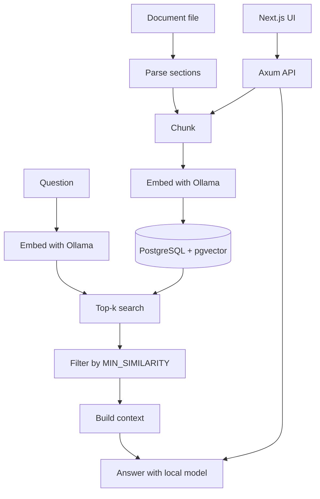

# RAG Learning Project

A Rust project for learning Retrieval-Augmented Generation (RAG) from first
principles. It chunks a document, embeds the chunks with a local Ollama server,
stores them in PostgreSQL with pgvector, retrieves the closest chunks for a
question, and asks a local model to answer using only those chunks. Separate
commands score retrieval quality and run a bilingual evaluation harness.

Four CLI commands drive it — `ingest` loads a document (PDF, Markdown, or plain
text), `query` answers a question with cited evidence, `eval` scores retrieval,
and `expbilingual` runs the RAG-024 bilingual evaluation arms. The Axum `api`
binary serves the Next.js browser UI. The full list, including the `make`
shortcuts, is in the [command reference](docs/reference/commands.md).

## Architecture



Retrieval is hybrid: vector search and PostgreSQL full-text search are fused with
reciprocal rank fusion, the top sections are deduplicated and expanded, and an
optional answerability gate decides whether the evidence can answer at all. The
embedder and generator are resolved through a provider registry (`EMBED_PROVIDER`
/ `GEN_PROVIDER`); an unregistered provider fails fast at configuration load and
only `ollama` is registered today. See the
[architecture overview](docs/architecture/OVERVIEW.md) for the full picture.

## Requirements

- Rust, using the channel pinned in [`rust-toolchain.toml`](rust-toolchain.toml).
  With `rustup` installed, the pinned toolchain and components install
  automatically when you run `cargo` in this repository.
- Ollama running locally, with an embedding model and a chat model:

  ```bash
  ollama pull nomic-embed-text
  ollama pull qwen3.8:27b-mlx   # or set OLLAMA_CHAT_MODEL to a model you have
  ```

- Docker (for the bundled PostgreSQL + pgvector)

## Quick start

Start the database and apply the migrations, then ingest a document, ask a
question, and score retrieval:

```bash
make db-up
make ingest
make ask Q="What happens if someone misses a payment?"
make eval
```

Every setting is read from the environment; [`.env.example`](.env.example) lists
them all. Copy it to `.env` and load it into your shell (the binaries read the
process environment, not `.env` directly):

```bash
cp .env.example .env
set -a; source .env; set +a
```

For running the commands directly, changing the embedding dimension, and the full
setup details, see the [usage guide](docs/guides/usage.md).

## Commands

| Command | What it does | Make target |
| ------- | ------------ | ----------- |
| `cargo run --locked --bin ingest <file>` | Chunk a file and store its embeddings (safe to re-run) | `make ingest FILE=…` |
| `cargo run --locked --bin query "question"` | Answer a question from the stored chunks with citations | `make ask Q="…"` |
| `cargo run --locked --bin eval` | Score retrieval against `evals/retrieval.json` | `make eval` |
| `cargo run --locked --bin expbilingual` | Run the RAG-024 bilingual evaluation arms over a frozen split | — (run directly) |
| `cargo run --locked --bin api` | Serve the Axum API for the Next.js UI on `127.0.0.1:8080` | — (run directly) |

Supporting `make` targets: `db-up`, `db-down`, `db-schema`, `test`, `fmt-json`,
and the Rust/web checks. See the [command reference](docs/reference/commands.md)
for flags and environment settings.

## Web UI

The real browser UI lives under `web/`. The browser calls only same-origin Next.js
`/api/*` endpoints; the Next.js server proxies them to the Rust Axum API, and the
API calls the same ingestion, retrieval, generation, and citation-validation
services as the CLI.

```bash
cargo build --locked --bin api
target/debug/api               # 127.0.0.1:8080
make web-start                 # 127.0.0.1:3000
make web-e2e                   # real-browser Playwright verification
```

See [web/README.md](web/README.md) and the
[RUST-008A browser evidence](docs/reference/rust-008a-browser-evidence.md).

## Rust-only layout

RUST-007C moved the Cargo package to the repository root and removed the Go
implementation, `go.mod`/`go.sum`, and Go-only tooling. The Rust package now
provides every command and the Axum API:

```bash
make rust-check      # fmt, build, test, clippy, final layout, clean checkout
make transition-evidence
```

The frozen transition record — capability matrix, remaining limitations,
rollback reference, pinned Go commit SHA, source repository URL, and fixture
provenance — is
[Rust transition evidence](docs/reference/rust-transition-evidence.md). The
pinned Go reference (`d72fb398e8959eea83ed24be03f6df8cdeca86a2`) and the frozen
`fixtures/parity/` outputs are preserved for audit; expected values are never
regenerated from Rust.

Frozen assets (`migrations/*.sql`, `evals/`, `examples/`, `docker-compose.yml`,
`fixtures/`) are read-only inputs.

`expbilingual` is evaluation-only: it does **not** modify production retrieval.
It selects an arm with `ARM` (`A`, `B`, `C`, `D1`, `D2`, `E`, or `all`), reads its
cases from `EVAL_DATASET`, pins generation (temperature 0, fixed seed, bounded
output), and caches results by case id and configuration. Its contract is in
[RUST-007D-bilingual-contract.md](docs/reports/rust-migration/RUST-007D-bilingual-contract.md).

## Documentation

The full index — with a one-line "when to read it" for every document — lives in
[docs/README.md](docs/README.md). The major areas:

| Area                                                 | What is here                                                                                                                                                                                                                                                    |
| ---------------------------------------------------- | --------------------------------------------------------------------------------------------------------------------------------------------------------------------------------------------------------------------------------------------------------------- |
| [Requirements](docs/requirements/PRD.md)             | The canonical PRD, and the phase-23b PRD for proposed work                                                                                                                                                                                                      |
| [Architecture](docs/architecture/OVERVIEW.md)        | The RAG loop, package responsibilities, and boundaries                                                                                                                                                                                                          |
| [Reference](docs/reference/commands.md)              | Commands, [configuration](docs/reference/configuration.md), [capabilities](docs/reference/capabilities.md), [project structure](docs/reference/project-structure.md), [testing](docs/reference/testing.md), [experiments](docs/reference/experiments.md)        |
| [Guides](docs/guides/usage.md)                       | Task-oriented how-tos: [usage](docs/guides/usage.md), [evaluation](docs/guides/evaluation.md), [git hooks and agent scripts](docs/guides/agent-scripts.md)                                                                                                      |
| [Operations](docs/operations/embedding-dimension.md) | Operator-run procedures: [embedding dimension](docs/operations/embedding-dimension.md), [embedding models](docs/operations/embedding-models.md), [page provenance](docs/operations/page-provenance.md), [prompt injection](docs/operations/prompt-injection.md), [platform support](docs/operations/platform-support.md) |
| [Plans](docs/plans/PLAN.md)                          | The [engineering and learning plan](docs/plans/PLAN.md), focused SOP-compatible task plans (RAG-*), and the [deferred bilingual backlog](docs/plans/BACKLOG-RAG-007.md)                                                                                          |
| [History](docs/history/lessons.md)                   | Completed experiment/acceptance evidence and the non-normative [lessons-learned](docs/history/lessons.md) retrospective                                                                                                                                    |

## Status

The ingestion → chunking → embedding → retrieval → answer loop is complete, and
the gap-closure capabilities (RAG-006…RAG-015) are shipped and covered by tests —
see the [capabilities reference](docs/reference/capabilities.md). PDF text-layer
ingestion (RAG-007) and page provenance / page-aware citations (RAG-017) are also
implemented; the [architecture overview](docs/architecture/OVERVIEW.md) records
what ships today. The final repository is Rust-only: RUST-007C removed the Go
implementation after the Rust port passed its parity, live-RAG, and browser
acceptance gates. OCR for scanned PDFs (RAG-008) and genealogy entity extraction
(RAG-016) are **not** implemented.

## Learning path

1. Generate embeddings with Ollama
2. Measure cosine similarity
3. Read raw embedding vectors from the Ollama `/api/embed` response
4. Add document chunking (now tunable: `CHUNK_SIZE` / `CHUNK_OVERLAP`)
5. Store embeddings in PostgreSQL + pgvector
6. Retrieve top-k chunks
7. Send retrieved context to a local Qwen model
8. Add metadata and citations
9. Add hybrid search and reranking (`eval` compares a lexical and an LLM reranker)
10. Add evaluation (`eval` reports recall and precision)
11. Add query transformation and multi-query retrieval (`QUERY_REWRITE`)
12. Gate answers on answerability, and judge facts, groundedness, and citations
13. Measure changes with `cargo run --locked --bin eval` instead of guessing
