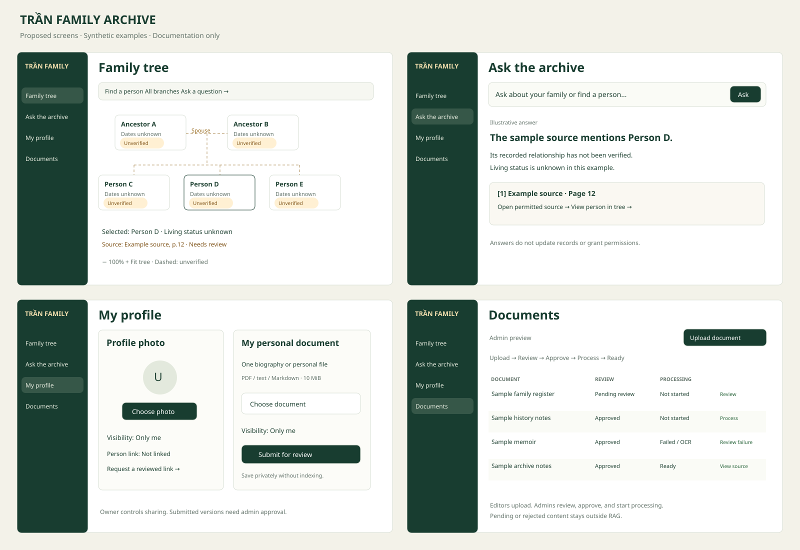

# Family archive mockup

**Status:** Proposed design. All people, accounts, and citations are synthetic.

## Open the interactive mockup

Download [index.html](./index.html) with GitHub's **Raw / Download raw file** action.
Open the downloaded file in a browser. It is self-contained and needs no server,
dependencies, network, or credentials. GitHub shows HTML source rather than running it.

Use the sidebar to switch between:
- **Family tree:** Selected-person details and descendant collapse/expand.
- **Ask the archive:** A question-focused input and an illustrative cited answer.
- **My profile:** One photo, one document, visibility, and a reviewed person-link request.
- **Documents:** Admin/editor/viewer previews and separate review/processing states.

The document role selector simulates visible controls and rows. It is not an
authorization implementation. Production Rust endpoints must enforce permissions.
The mockup reads no files, sends no questions, uploads nothing, and changes no
persistent state. Other action buttons show explanatory feedback. Zoom, search,
source navigation, uploads, and processing are layout examples, not working features.

The static SVG is an overview, not a screenshot of the production app. Print the
HTML to inspect all four screens. The proposed styling uses an evergreen sidebar,
ivory canvas, serif headings, and evidence details beside the tree.

## Review decisions

- Keep person lookup separate from the question-focused **Ask the archive** screen.
- Personal assets default to **Only me**. Review access applies only to an explicitly submitted version.
- General uploads require editor/admin permission; review and processing require admin permission.
- Admin-uploaded files still need a recorded approval before processing.
- An approved document is not ready for retrieval until processing succeeds.
- Document approval does not verify genealogy assertions.
- Uncertain relationships remain uncertain. No real Head of Family is selected.

See [PLAN-TRAN-FAMILY-TREE.md](../../plans/PLAN-TRAN-FAMILY-TREE.md) for
dependencies, proposed permissions, tasks, acceptance criteria, and the agent handoff.
