# UI reskin — stage 1

**Status:** Implemented; awaiting review. **Scope:** shared shell, shared design
tokens, and the existing **Ask the archive** screen at `/ask`.

## Direction

The interface now uses neutral surfaces, one restrained jade accent, subtle
borders, near-flat depth, and a readable sans-serif stack. It follows the
reader's light or dark system preference through CSS only. There is no theme
provider, no command palette, no new dependency, and no change to routes,
APIs, authentication, permissions, retrieval, or document approval.

The warm paper background, evergreen sidebar, serif interface headings, mint
glow, dot grid, and gradient button fills were removed. The jade accent is
reserved for primary actions, selected navigation, links, and focus. Status
colours remain semantic and always carry a text label.

## Before

The baseline was captured against the pre-change app with synthetic intercepted
data. The previous design had a dark evergreen sidebar and warm paper canvas,
with no dark theme.

| Desktop idle | Desktop answered | Mobile answered |
| --- | --- | --- |
| 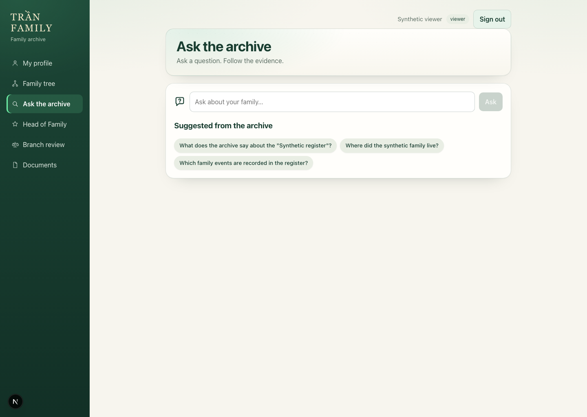 | 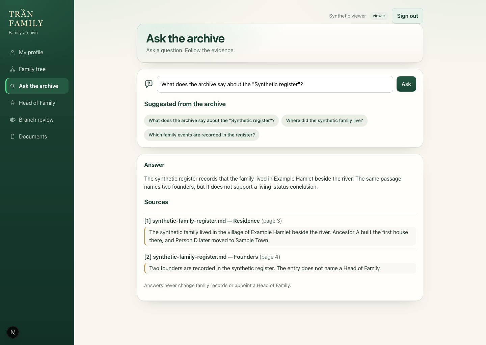 | 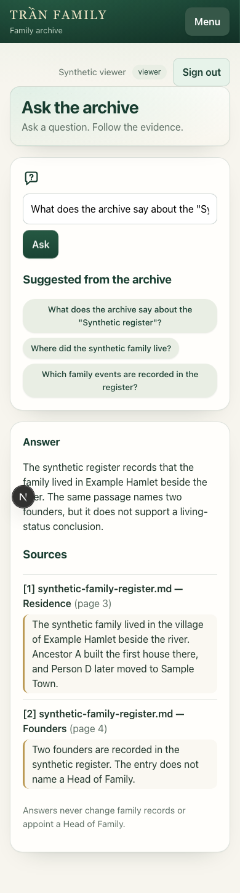 |

## After

| Desktop light idle | Desktop light answered |
| --- | --- |
| 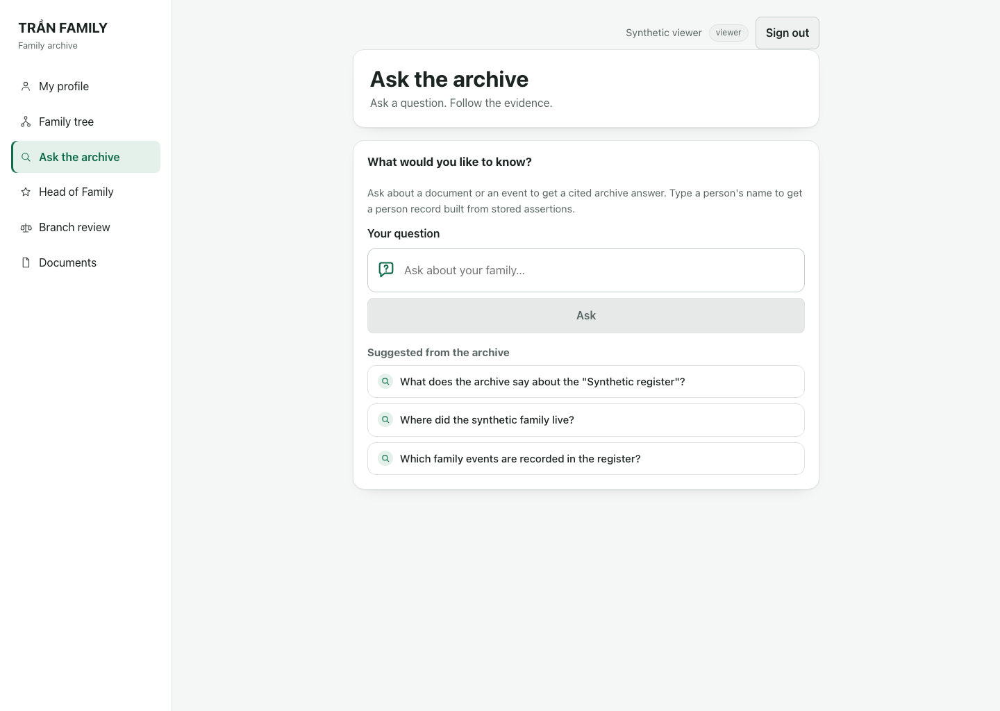 | 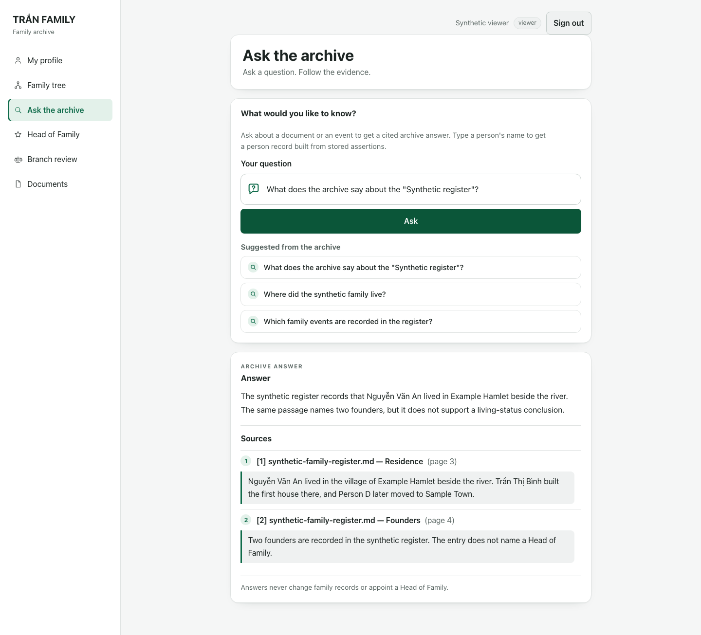 |

| Desktop dark answered | Mobile light answered | Mobile dark answered |
| --- | --- | --- |
| 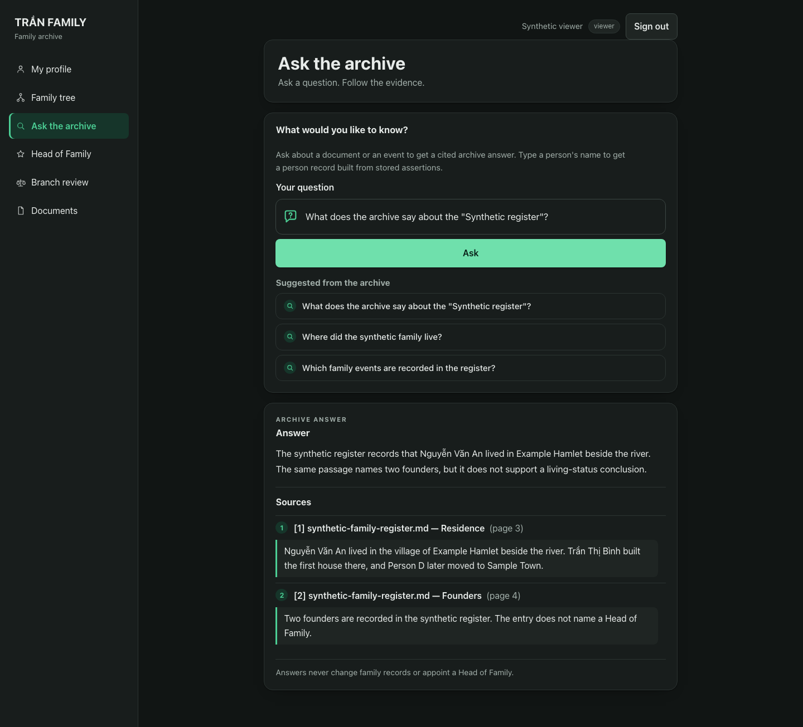 | 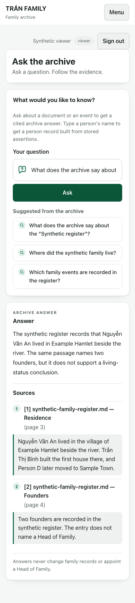 | 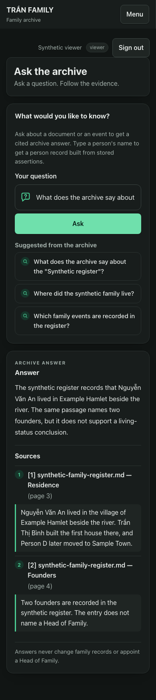 |

Additional state captures:

| Loading | Empty | Error | Insufficient |
| --- | --- | --- | --- |
| 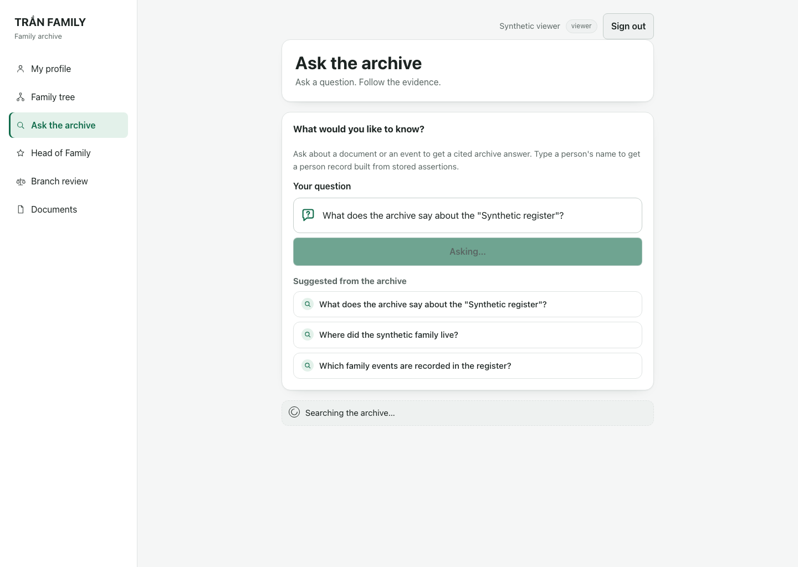 | 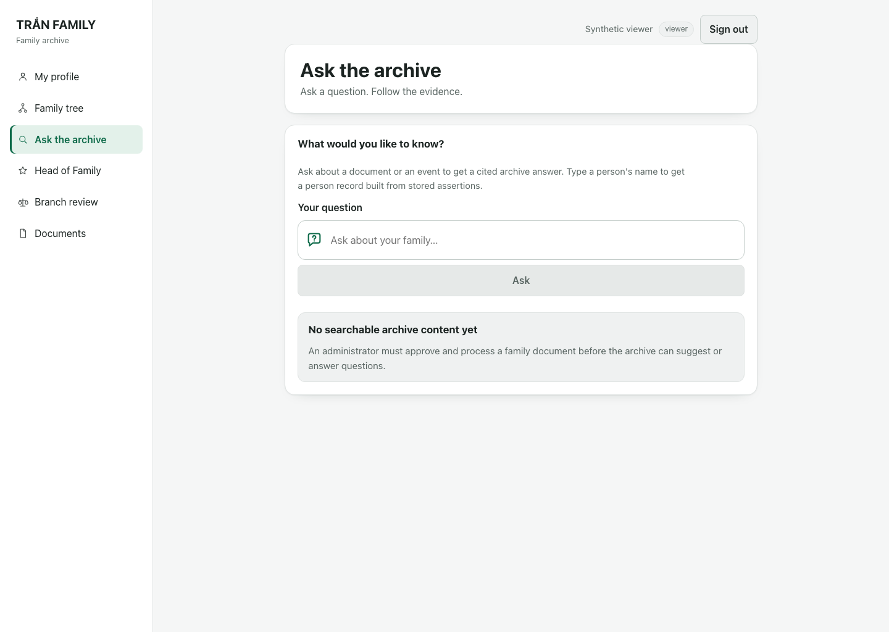 | 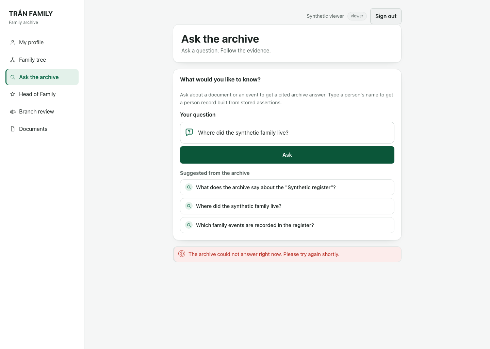 | 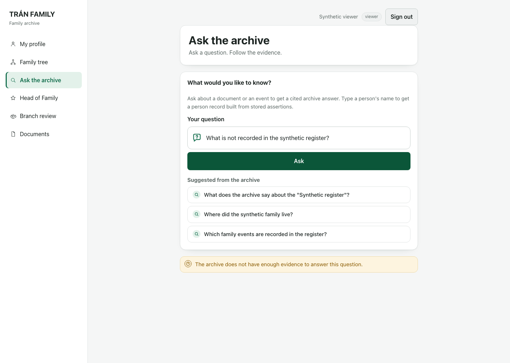 |

| Mobile light navigation open | Mobile dark navigation open |
| --- | --- |
| 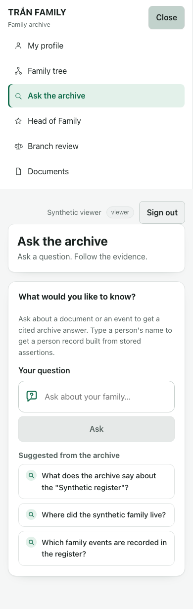 | 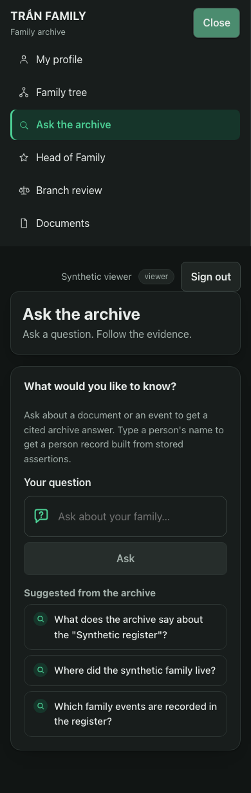 |

All screenshots use synthetic labels, synthetic sources, and synthetic
citations. The after captures use `Nguyễn Văn An` and `Trần Thị Bình` to verify
Vietnamese diacritics; no real family data is present. The capture tool hides
the Next.js development indicator so it is not mistaken for product UI.

## What changed

- `web/src/app/globals.css`: semantic light/dark tokens for colour, type,
  spacing, radii, borders, shadows, and focus; neutral shell and page styles;
  shared buttons, inputs, panels, alerts, badges, status chips, and citation
  previews; hard-coded legacy surfaces converted to tokens for dark-mode
  readability.
- `web/src/components/ExperienceShell.tsx`: skip-to-content link and a stable
  main-content target. Existing navigation labels, order, icons, role gating,
  account states, and mobile toggle behaviour are unchanged.
- `web/src/app/ask/page.tsx`: a question panel with a visible label and
  prominent input, a clear archive-versus-person explanation, readable
  suggestions, distinct state notices, a readable answer measure, and
  numbered citation previews.
- `web/src/components/PersonAnswer.tsx`: a “Person record” eyebrow so person
  answers are visibly distinct from archive answers. Evidence links and the
  profile link are unchanged.
- `web/src/app/layout.tsx`: keeps `lang="en"` because the interface copy is
  English; Vietnamese content renders through the system font stack.
- `web/e2e/experience.spec.ts`: one regression test proving a recoverable 503
  keeps the entered question.
- `web/scripts/capture-ui-reskin.mjs`: reproducible synthetic screenshot tool.
- `docs/reference/brand.md`: updated to the neutral jade direction, token
  tables, light/dark policy, typography, and accessibility rules.
- `docs/plans/PLAN-TRAN-UI-RESKIN-STAGE-1.md`: the executed stage-one plan.

## Verification

| Check | Result |
| --- | --- |
| `scripts/web-control.sh typecheck` (`tsc --noEmit`) | **PASS** |
| `scripts/web-control.sh build` (`next build`, isolated `.next-build`) | **PASS** |
| `npx playwright test e2e/experience.spec.ts` | **PASS — 34/34** (22.2s) |
| Shell smoke: 13 routes × desktop/mobile × light/dark | **PASS — 52 checks**, 0 horizontal overflow, 0 page errors |
| `sop validate` (build, unit test, PostgreSQL integration, fmt, clippy) | **PASS** |
| Real-browser RAG spec (`PLAYWRIGHT_ARGS=e2e/rag.spec.ts`) | **Partial** — see below |
| `auth.spec.ts` standalone | **Not runnable standalone** — the first case needs the disposable OIDC issuer that `scripts/web-e2e.sh` starts; the second case passed |

The shell smoke checked `/`, `/ask`, `/genealogy`, `/profile`, `/documents`,
`/head-of-family`, `/branch-review`, `/family/synthetic-person`, and the five
admin routes at 1440×1024 and 390×844 in both themes.

### Real-browser RAG result

The real-browser RAG harness uploaded and processed both fixtures and answered
the first grounded question (PDF page two) through the redesigned Ask screen.
The follow-up Markdown question returned a 200 answer on its first attempt that
did not match the expected `grace period` / `loan-policy.md` citation within the
test window, then returned **503 after 224 seconds** of generation on the next
attempt. Two suggestion-state tests passed; five tests did not run because the
serial suite stopped at that failure.

This is an Ollama generation timeout/availability result, not a UI regression:
the API and retrieval behaviour are unchanged by this PR, and the same Ask
states are covered by the mocked 34-test suite. The real harness was run on an
isolated API port and disposable databases so the existing local services were
not modified.

## Known limitations

- The in-app theme follows the system preference only; there is no manual theme
  switch in this stage.
- Other screens inherit the shared tokens and primitives but were not
  individually redesigned.
- The local Next.js build logs a workspace-root warning because more than one
  lockfile exists above the web app. The build succeeds, and no dependency file
  was changed.
- The real RAG browser spec did not complete because of the live model timeout
  described above. It should be rerun with a healthy local chat model before
  merge if the operator wants a complete live-browser record.

## Next reskin stage

The remaining screens, in suggested order:

1. Family tree and person details (`/genealogy`, `/family/[personKey]`).
2. My profile and its revision/media states (`/profile`).
3. Documents and review consoles (`/documents`, `/admin/reviews`,
   `/branch-review`).
4. Head of Family (`/head-of-family`).
5. Admin extraction, narrative review, source of truth, and bulk onboarding
   (`/admin/document-extraction`, `/admin/narrative-review`,
   `/admin/source-of-truth`, `/admin/family-members`).
6. Sign-in (`/signin`) and the remaining empty/denied states.

## Reproduce the screenshots

```sh
# with the Next.js app running on 127.0.0.1:3000
cd web
node scripts/capture-ui-reskin.mjs
```

The tool intercepts only `/api/auth/session`, `/api/query/suggestions`, and
`/api/query`. It needs no database, Ollama, or credentials. Override `BASE_URL`
or `OUT_DIR` when needed.
