# UI reskin — stage 3

**Status:** Implemented; awaiting review. **Scope:** the shared application
shell, top navigation, and the Linear-inspired light/dark palette. Stage 1
(`#101`) and stage 2 (`#102`) remain unchanged in scope and behavior.

## Direction

The left sidebar is gone. Every shared-shell page now uses a slim top header:
the family brand on the left, three primary destinations in the header, a
**More** menu for the remaining destinations, and account actions at the far
right. Below the header breakpoint, one **Menu** button exposes all permitted
destinations.

The palette now follows the requested Linear-inspired direction: white and cool
neutral surfaces in light mode, near-black and charcoal surfaces in dark mode,
jade for links/selected states/focus, and neutral primary buttons. Green is no
longer the default fill for every button.

No route, API, authentication, authorization, retrieval, document-approval, or
genealogy behavior changed. Menu visibility remains presentation only; Rust
continues to enforce every request.

## Before

The pre-change shell used the stage-one left sidebar and the previous warm-neutral
palette.

| Desktop light Ask                                            | Desktop dark Ask                                           |
| ------------------------------------------------------------ | ---------------------------------------------------------- |
| 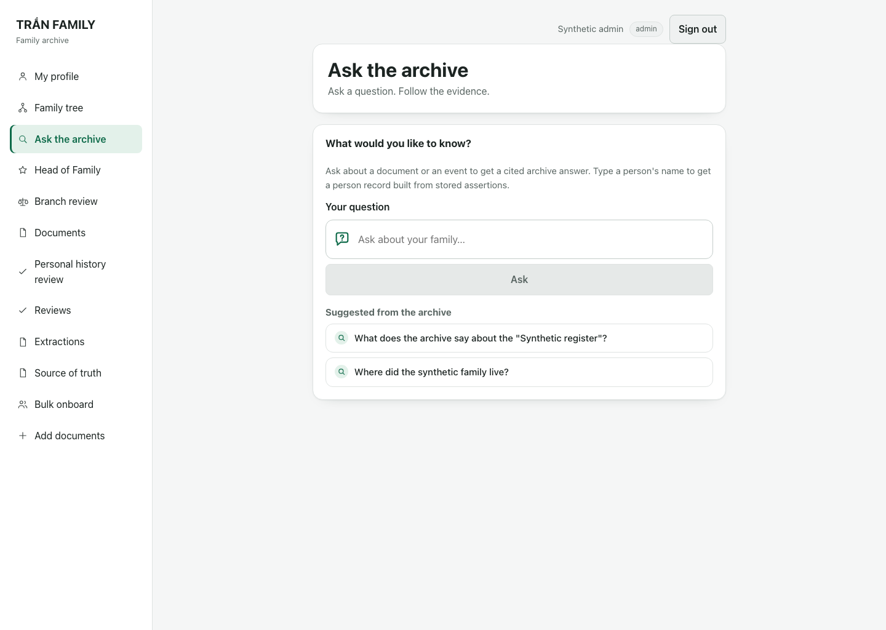 | 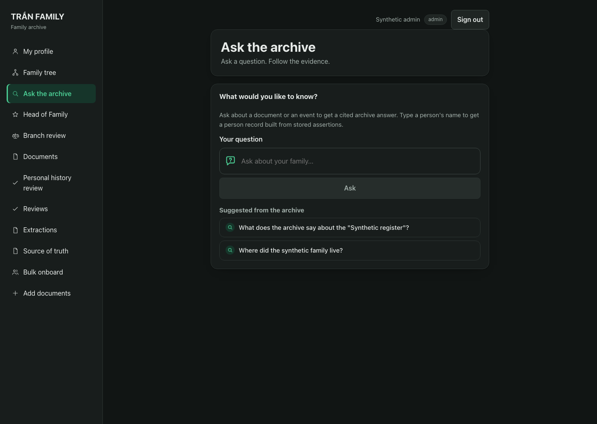 |

| Desktop light review                                                     | Desktop dark review                                                    |
| ------------------------------------------------------------------------ | ---------------------------------------------------------------------- |
| 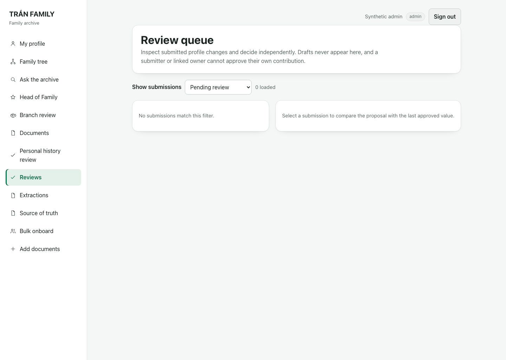 | 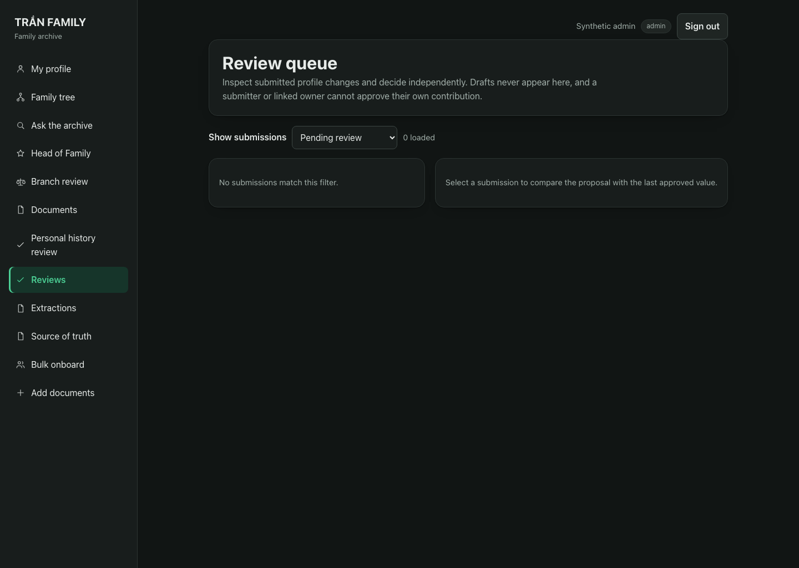 |

| Mobile light menu                                                 | Mobile dark menu                                                |
| ----------------------------------------------------------------- | --------------------------------------------------------------- |
| 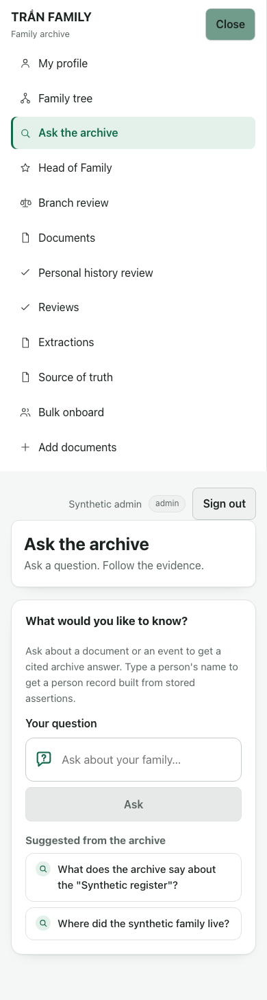 | 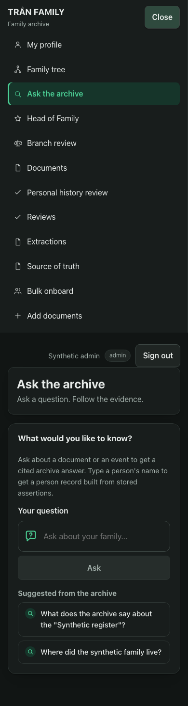 |

## After

### Desktop

| Light Ask                                                  | Dark Ask                                                 |
| ---------------------------------------------------------- | -------------------------------------------------------- |
| 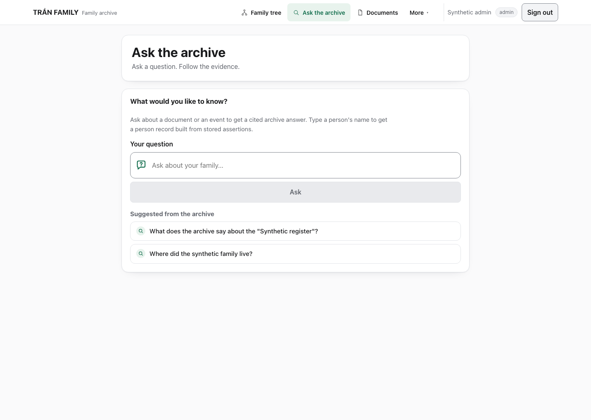 | 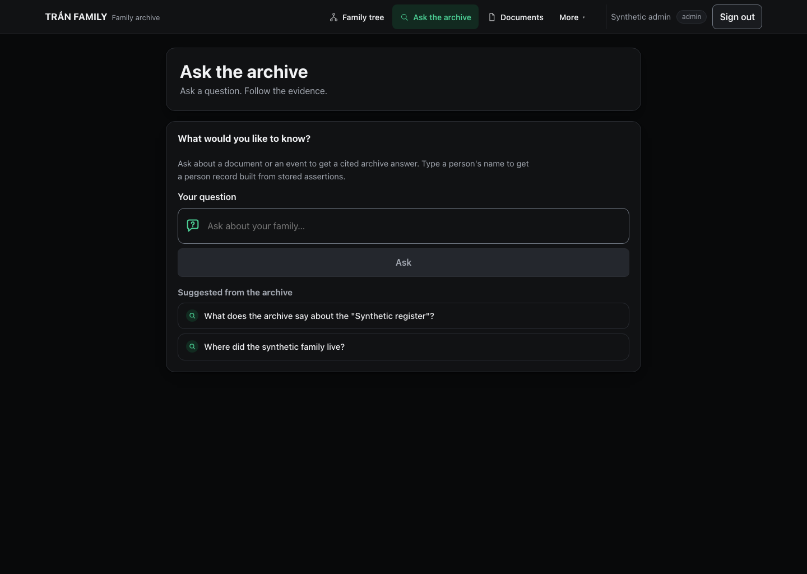 |

| Light More                                                        | Dark More                                                       |
| ----------------------------------------------------------------- | --------------------------------------------------------------- |
| 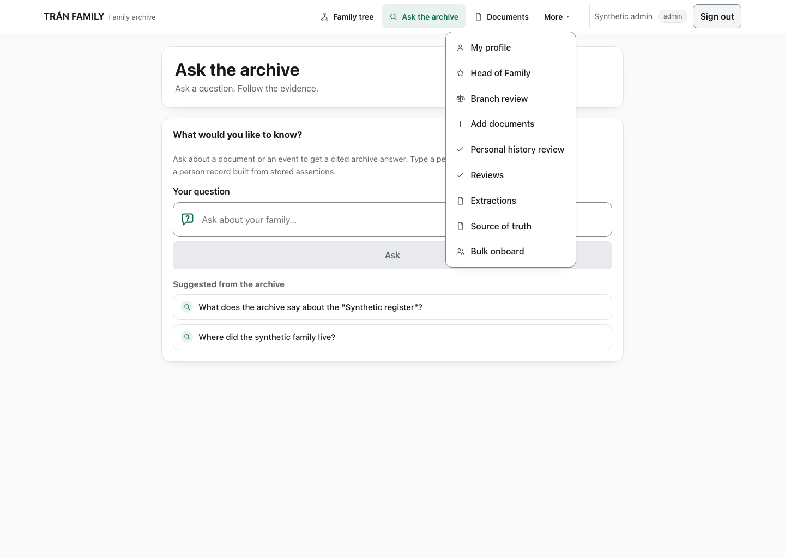 | 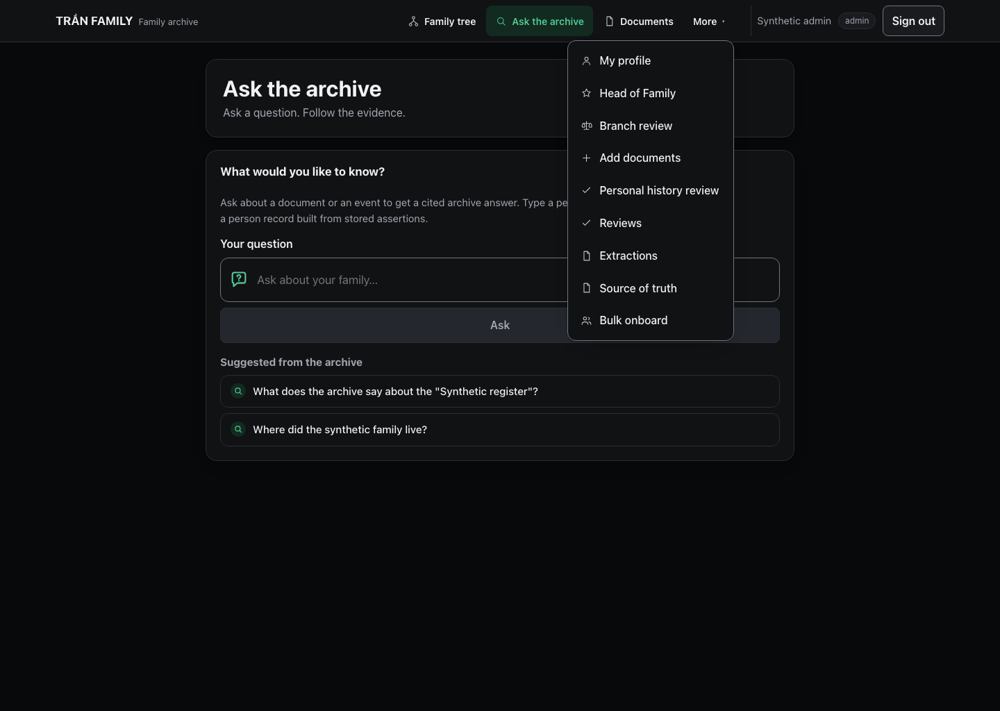 |

The header keeps the brand left and account actions right. Family tree, Ask the
archive, and Documents are direct links. Every other permitted destination is in
**More**. The current destination is marked with the jade selected surface; when
it is inside More, the More control also carries the current-page state.

### Admin review

| Light                                                                  | Dark                                                                 |
| ---------------------------------------------------------------------- | -------------------------------------------------------------------- |
| 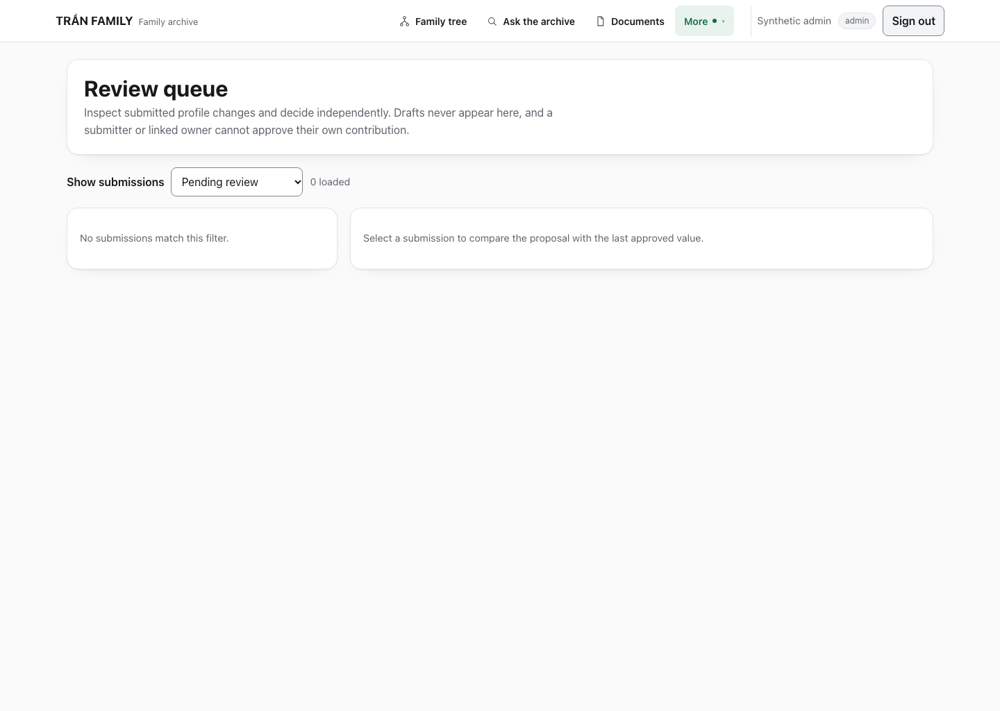 | 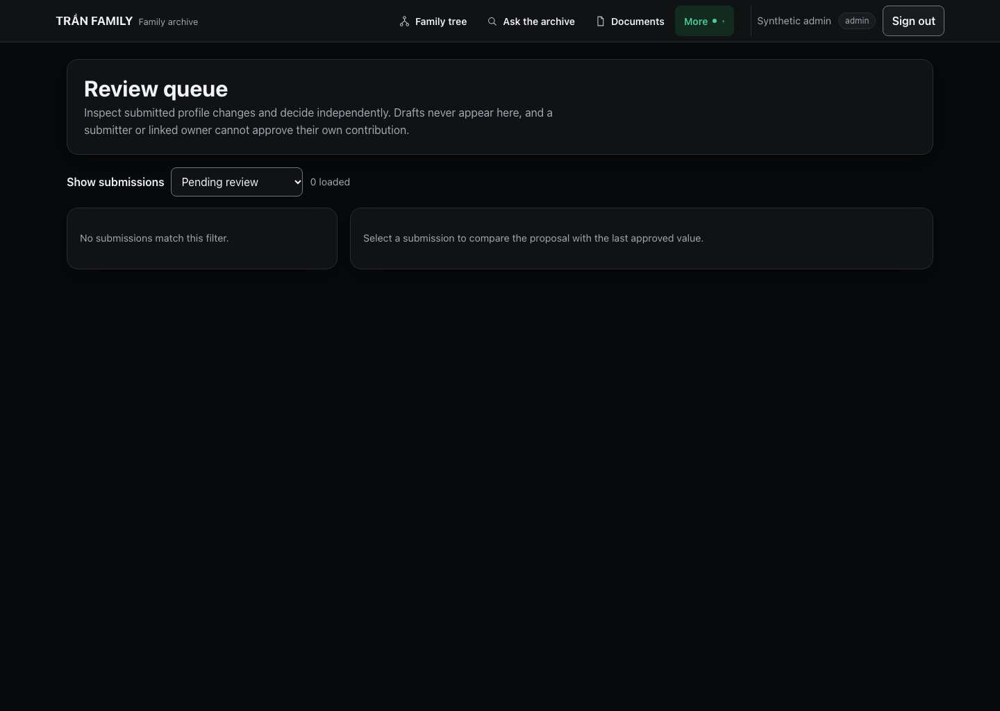 |

The review console keeps its existing wide layout. The new header removes the
sidebar gutter without reducing the review workspace.

### Mobile

| Light menu                                                      | Dark menu                                                     |
| --------------------------------------------------------------- | ------------------------------------------------------------- |
| 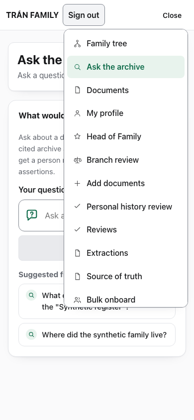 | 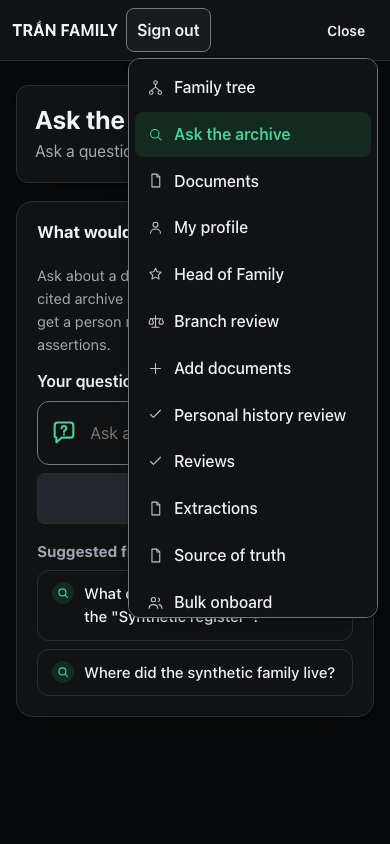 |

At 390 px the primary links and More are replaced by one Menu button. The menu
contains every permitted destination, stays inside the viewport, scrolls when
long, and closes after navigation. Account actions remain available; the display
name and role badge are hidden below 760 px to keep the header compact.

## What changed

- `web/src/components/ExperienceShell.tsx`: semantic top header, primary/More
  navigation split, desktop More popup, mobile Menu navigation, current-page
  state, Escape/outside-click/focus-leave dismissal, and focus return.
- `web/src/app/globals.css`: stage-three light/dark tokens, neutral action tokens,
  neutral shadows, header/dropdown/mobile-menu styles, 44 px targets, and narrow
  viewport handling.
- `web/e2e/experience.spec.ts`: primary links, More contents for viewer/editor/
  admin, current-state behavior, mobile menu contents and overflow, Escape/focus,
  outside click, and light/dark token assertions.
- `web/e2e/branch-review-ui.spec.ts` and
  `web/e2e/branch-review-security.spec.ts`: updated to the primary/More selectors
  without weakening permission assertions.
- `docs/reference/brand.md`: palette, action policy, wordmark location, and shell
  wording updated to stage three.
- `web/scripts/capture-ui-reskin-stage3.mjs`: synthetic before/after capture tool.
- `docs/plans/PLAN-TRAN-UI-RESKIN-STAGE-3.md` and
  `docs/plans/tran-top-navigation-requirement.md`: stage contract.

## Verification

| Check                                                                   | Result           |
| ----------------------------------------------------------------------- | ---------------- |
| `./scripts/web-control.sh typecheck`                                    | **PASS**         |
| `./scripts/web-control.sh build` (Next 16.4.2)                          | **PASS**         |
| `npx playwright test e2e/experience.spec.ts` against the isolated build | **PASS — 39/39** |
| `npx playwright test e2e/family-tree.spec.ts`                           | **PASS — 58/58** |
| `npx playwright test e2e/family-profile-visual.spec.ts`                 | **PASS — 4/4**   |
| Mobile overflow assertion with the menu open                            | **PASS — 0 px**  |
| Light/dark semantic token assertions                                    | **PASS**         |
| `git diff --check`                                                      | **PASS**         |

The browser run used an isolated production build on `127.0.0.1:3001`; the
existing local app and API were left untouched. All screenshots use a synthetic
admin session and synthetic suggestions/review queue.

One existing family-tree retry test assumed the development server's doubled
effect. It now enables recovery explicitly at retry time, so the same assertion
works against both the dev server and the production build.

### Not run

- `branch-review-ui.spec.ts` and `branch-review-security.spec.ts` require the
  real API, synthetic OIDC issuer, and seeded disposable databases started by
  `scripts/web-e2e.sh`. Their harness ports were already occupied by the local
  app/API, so they were **not** started for this verification. The selector
  changes are covered by typecheck and the shared navigation suite; the full
  branch-review matrix remains a CI/operator check.
- The stage-one live-RAG timeout remains **outstanding** and was not rerun for
  this visual change.

## Known limitations

- The theme still follows the system preference only; no manual theme selector
  was added.
- The mobile navigation is a compact dropdown panel rather than a full-width
  sheet. It stays in the viewport, scrolls for long admin menus, and closes after
  navigation.
- Account display name and role are hidden below 760 px; the sign-in/sign-out
  action stays visible.
- Other screens inherit the shared tokens and header but were not individually
  redesigned in this stage.
