# UI reskin — stage 4

**Status:** Implemented; awaiting review. **Scope:** the owner profile at
`/profile`, including revision, photo/document, feedback, privacy, and session
states. The stage-3 shell and light/dark tokens are reused unchanged.

## Direction

The owner profile now reads as the same application as the family tree, Ask the
Archive, and family profile: neutral section cards, quieter field surfaces,
restrained jade highlights, semantic status chips, and shared state panels.

The old text-glyph avatar fallback is gone. A profile without a photograph shows
the first letter of the display name. Existing approved photographs still take
priority. No API, privacy, review, upload, or publication behavior changed.

## Before

| Desktop light                                                        | Desktop dark                                                       |
| -------------------------------------------------------------------- | ------------------------------------------------------------------ |
| 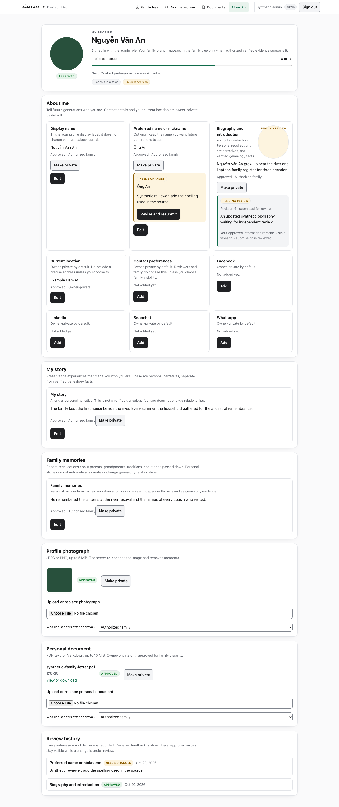 | 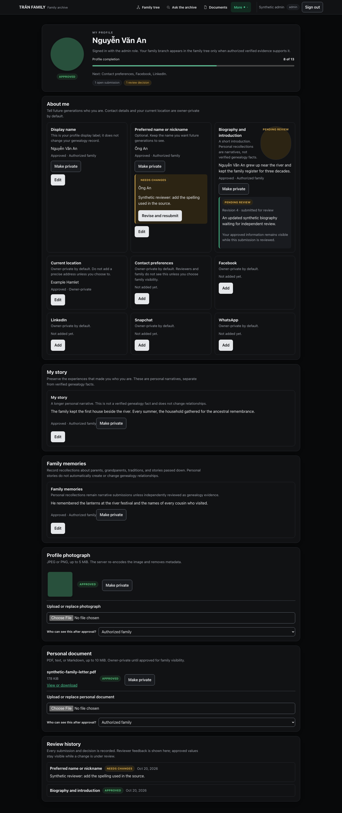 |

| No photograph (glyph fallback)                                | Editor                                               |
| ------------------------------------------------------------- | ---------------------------------------------------- |
| 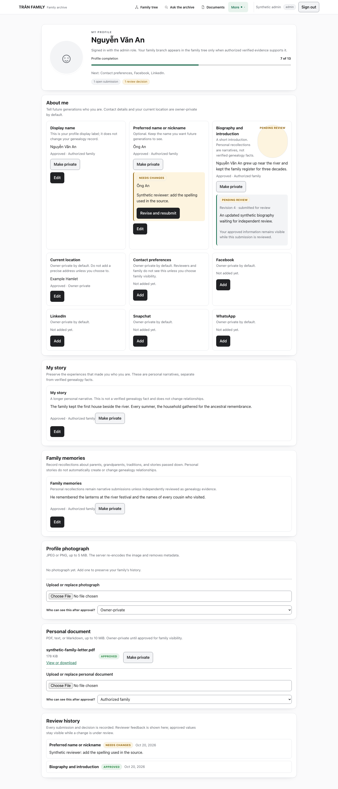 | 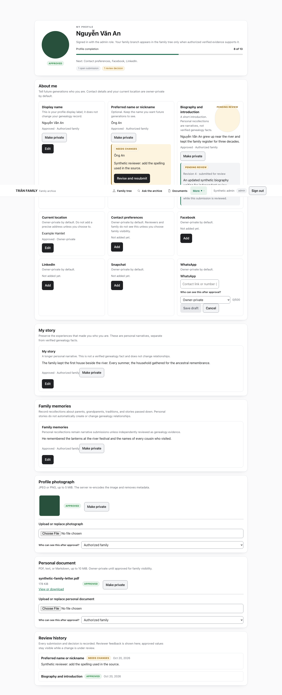 |

| Mobile light                                               | Unavailable                                                    |
| ---------------------------------------------------------- | -------------------------------------------------------------- |
| 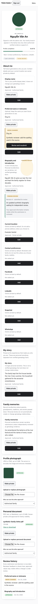 | 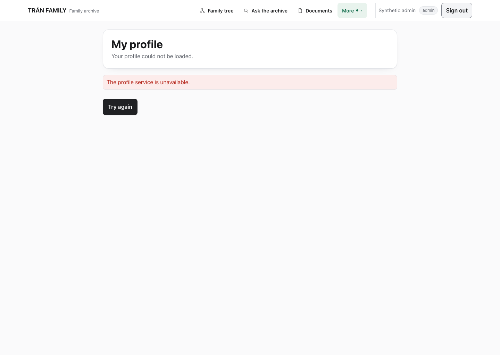 |

## After

### Desktop

| Light                                                              | Dark                                                             |
| ------------------------------------------------------------------ | ---------------------------------------------------------------- |
| 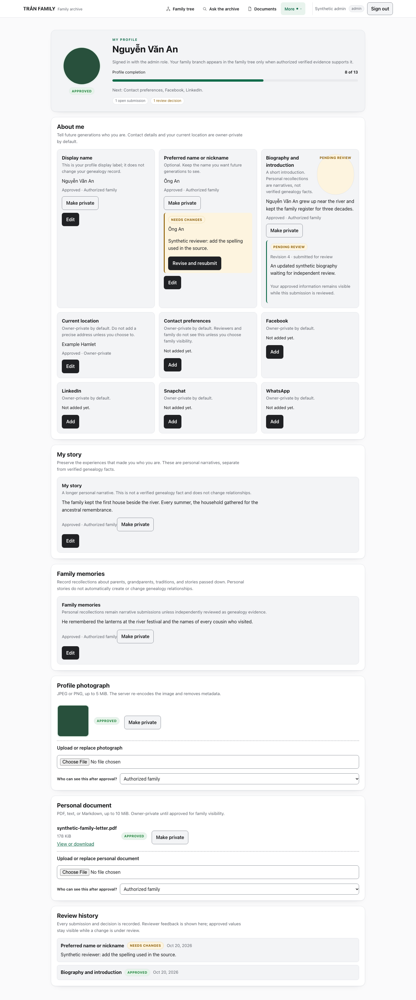 | 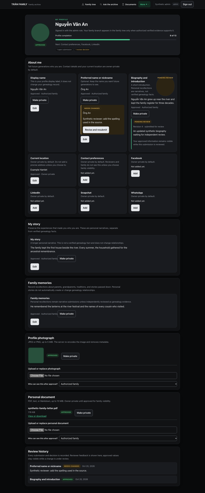 |

The hero keeps the name, role/session explanation, completion, open submissions,
and feedback count. Field cards use the quieter `--surface` layer inside the
white section card. Status chips stay semantic: approved green, pending/needs
changes amber, rejected red, draft neutral.

### Initials and editor

| Initials avatar                                        | Open editor                                        |
| ------------------------------------------------------ | -------------------------------------------------- |
| 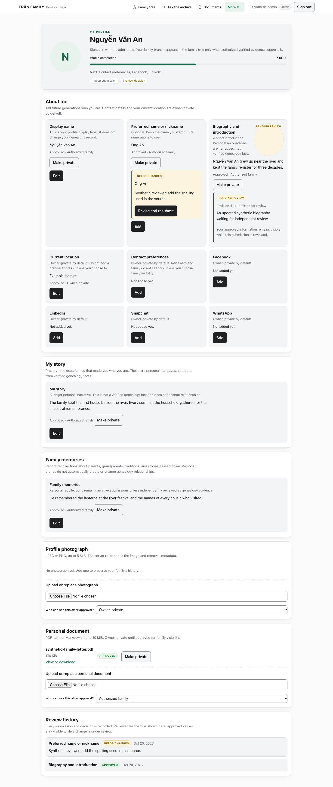 | 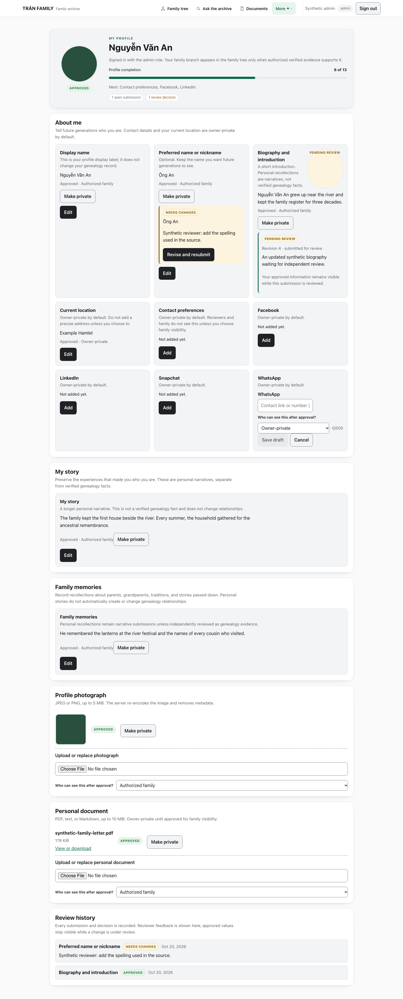 |

A profile without a photograph shows the first letter of the name in the shared
`--accent-soft` circle. The editor keeps the existing field, visibility, save,
submit, withdraw, and cancel behavior.

### Media and history

The full profile capture above includes the photo/document cards and review
history. The media cards keep current, pending, private, empty, upload, withdraw,
and make-private states. Review history keeps every decision and reviewer note.

### States

| Unavailable                                                  | Unlinked                                               |
| ------------------------------------------------------------ | ------------------------------------------------------ |
| 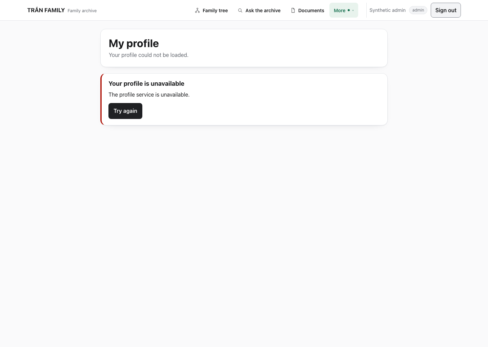 | 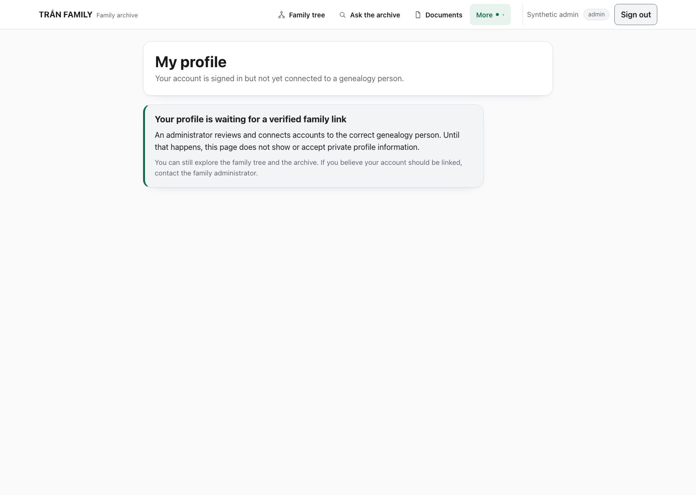 |

| Expired                                              | Sign in                                             |
| ---------------------------------------------------- | --------------------------------------------------- |
| 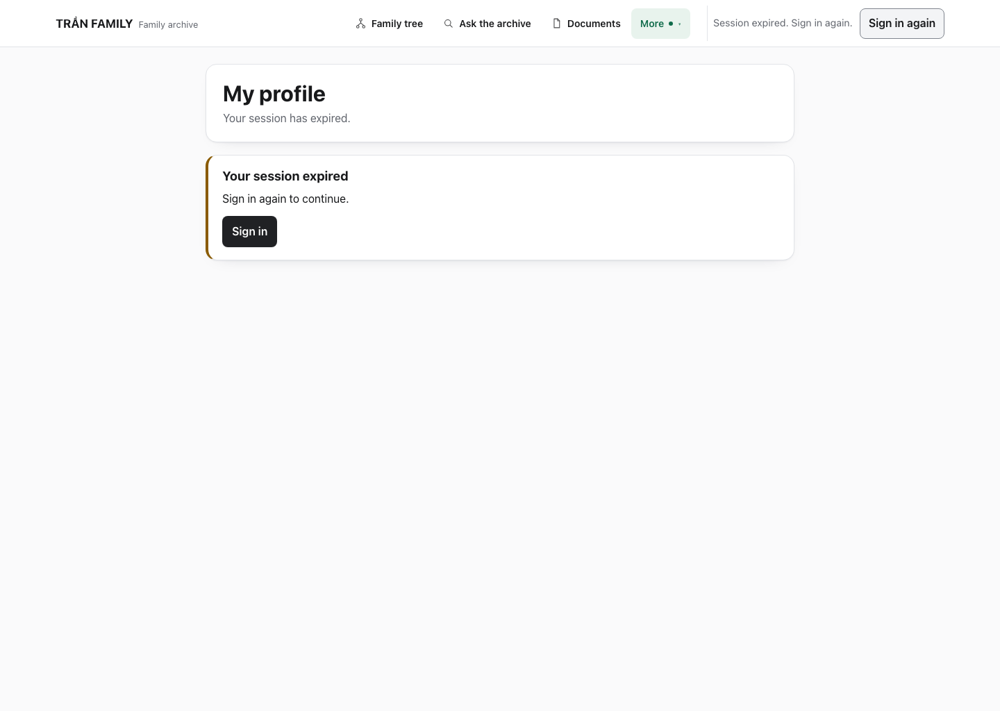 | 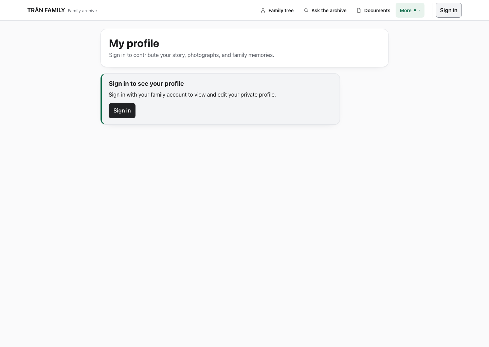 |

Loading, unavailable, unlinked, expired, sign-in, denied, and ready are distinct.
The unavailable state keeps a retry action; expired/sign-in keep the existing
safe invitation.

### Mobile

| Light                                                    | Dark                                                   |
| -------------------------------------------------------- | ------------------------------------------------------ |
| 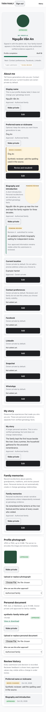 | 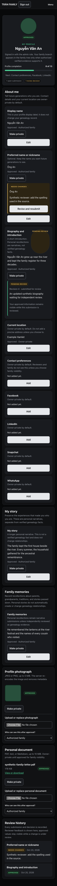 |

At 390 px the hero, sections, field cards, media, and actions stack with no
horizontal page overflow.

## What changed

- `web/src/components/MyProfile.tsx`: initials avatar, shared state panels for
  loading/expired/sign-in/error/unlinked, and the existing profile states retained.
- `web/src/app/globals.css`: profile-scoped surface hierarchy, 132px avatar,
  progress track, 44px actions, and responsive stacking.
- `web/e2e/my-profile-visual.spec.ts` (new): fully mocked ready, initials,
  loading, retry, expired, sign-in, unlinked, mobile/editor, and theme coverage.
- `web/scripts/capture-ui-reskin-stage4.mjs` (new): synthetic before/after capture
  tool.
- `docs/plans/PLAN-TRAN-UI-RESKIN-STAGE-4.md`: the stage-four contract.

No Rust, API, migration, authentication, authorization, privacy, review, upload,
or publication behavior changed.

## Verification

| Check                                                   | Result           |
| ------------------------------------------------------- | ---------------- |
| `./scripts/web-control.sh typecheck`                    | **PASS**         |
| `./scripts/web-control.sh build`                        | **PASS**         |
| `npx playwright test e2e/my-profile-visual.spec.ts`     | **PASS — 5/5**   |
| `npx playwright test e2e/experience.spec.ts`            | **PASS — 39/39** |
| `npx playwright test e2e/family-profile-visual.spec.ts` | **PASS — 4/4**   |
| 390px profile overflow assertion                        | **PASS — 0 px**  |
| 44px editor action assertion                            | **PASS**         |
| Progress value/max assertion                            | **PASS — 8/13**  |
| `git diff --check`                                      | **PASS**         |

The browser run used an isolated production build on `127.0.0.1:3001`; the
existing local app/API were left untouched. All screenshots use synthetic data.

### Not run

- The real-API `my-profile.spec.ts` suite requires the API, synthetic OIDC issuer,
  and seeded disposable databases from `scripts/web-e2e.sh`. Its harness ports
  were already occupied by the local app/API, so it was **not** started. Its
  existing test IDs and selectors are preserved; the new mocked suite covers the
  same rendering paths without real enforcement.
- The stage-one live-RAG timeout remains **outstanding** and was not rerun.
- Family-tree checks are unchanged from stage 3 and were not rerun.

## Known limitations

- Theme still follows the system preference only; no manual selector was added.
- The real-API profile suite remains operator/CI coverage because it requires the
  full disposable harness.
- Other screens inherit the shared tokens and shell but were not individually
  redesigned in this stage.
