# UI reskin — stage 5

**Status:** Implemented; awaiting review. **Scope:** the document workspace at
`/documents` and the two review consoles at `/admin/reviews` and
`/branch-review`. The stage-3 shell, top navigation, light/dark tokens, shared
state panels, and restrained jade are reused unchanged.

## Direction

The workspace now reads as the same application as the family tree, Ask the
Archive, the family profile, and the owner profile. Document and queue rows have
a clear hierarchy, status words stay visible inside semantic chips, and primary
decisions sit apart from destructive ones. On narrow screens the wide tables
become labelled stacked rows instead of horizontal scroll areas.

Every behavior is preserved: upload, submission, processing, publication,
review queues, filters, pagination, source previews, required notes, decisions,
self-approval and owner-linked blocks, branch scope, privacy, API contracts,
routes, permissions, and every existing test ID.

## Before

| Documents (desktop light)                                                  | Documents (390px light)                                                 |
| -------------------------------------------------------------------------- | ----------------------------------------------------------------------- |
| 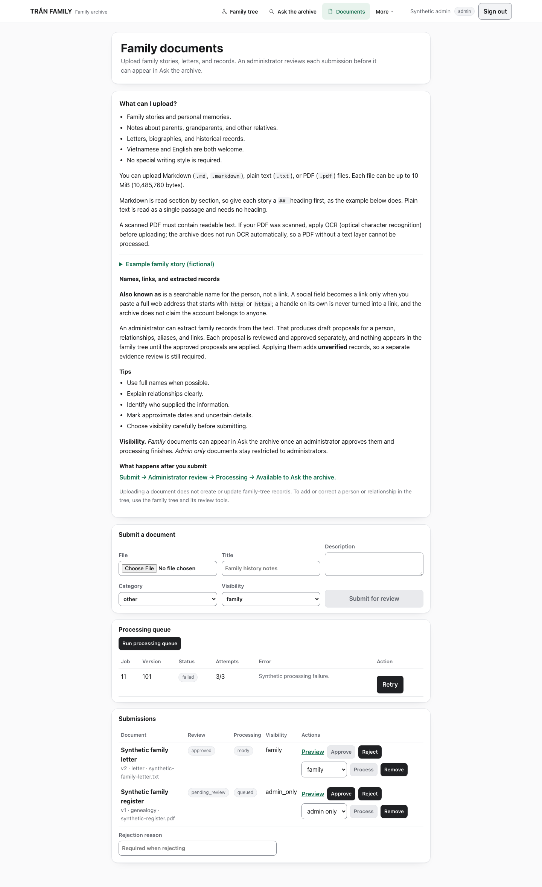         | 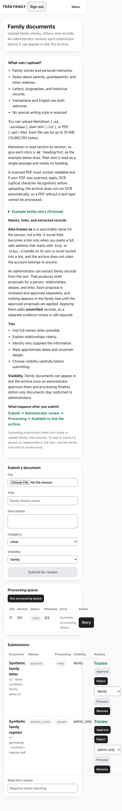        |
| **Admin review (desktop light)**                                           | **Branch review (desktop light)**                                       |
| 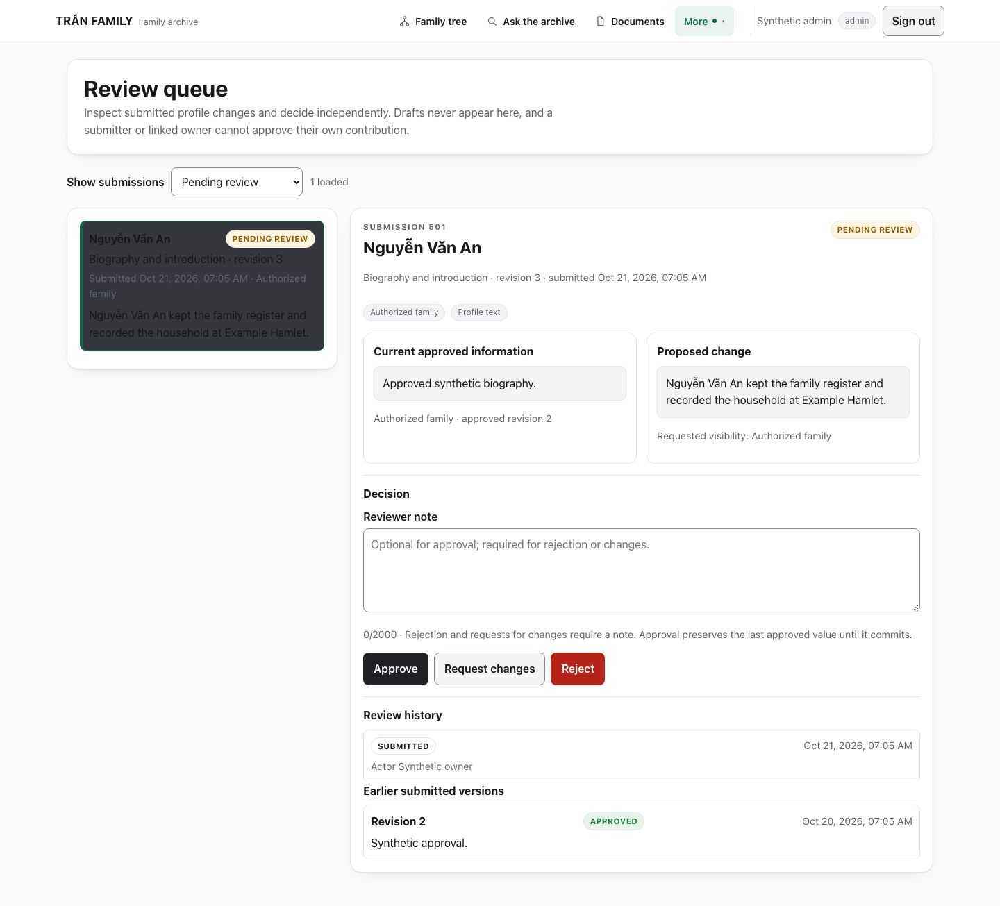          | 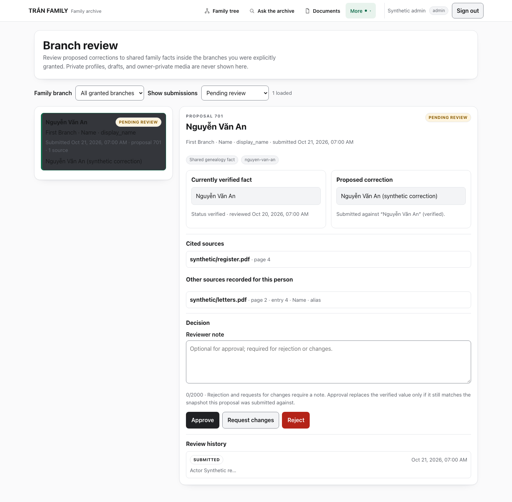      |

The baseline already passed the review/branch layout checks, but document rows
used raw enum text in gray badges, the submissions table overflowed by 168 px at
390 px, and a hovered selected review row inherited the primary action color.

## After

### Documents

| Light                                                              | Dark                                                             |
| ------------------------------------------------------------------ | ---------------------------------------------------------------- |
| 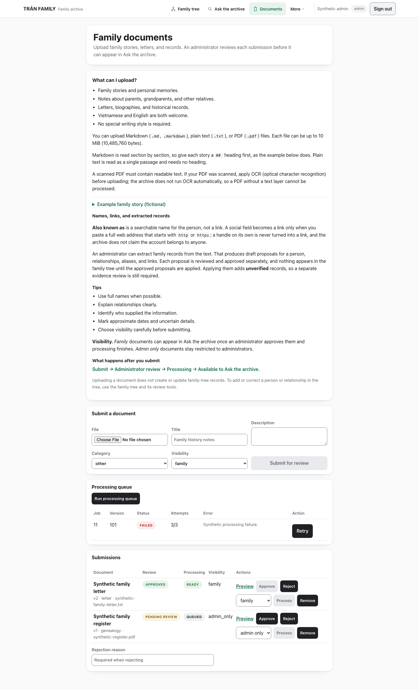 | 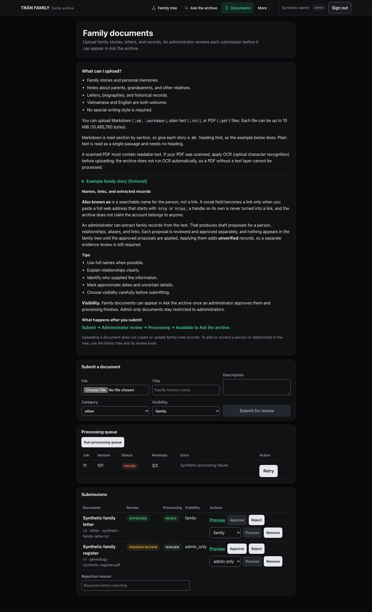 |

The upload form is one panel with a single primary submit action. Processing
jobs and submissions use semantic chips (`Approved`, `Ready`, `Pending review`,
`Queued`, `Failed`) instead of raw values. Preview, Approve, Reject, visibility,
Process/Promote, Retry, and Remove remain in the same order with the same
handlers. The rejection reason stays next to the review actions.

### Review consoles

| Admin review (light)                                                  | Branch review (dark)                                                    |
| --------------------------------------------------------------------- | ----------------------------------------------------------------------- |
| 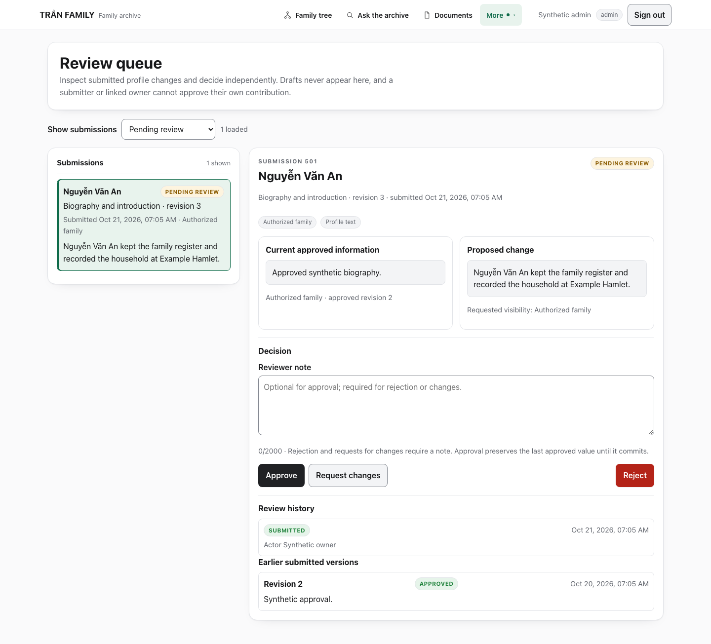       | 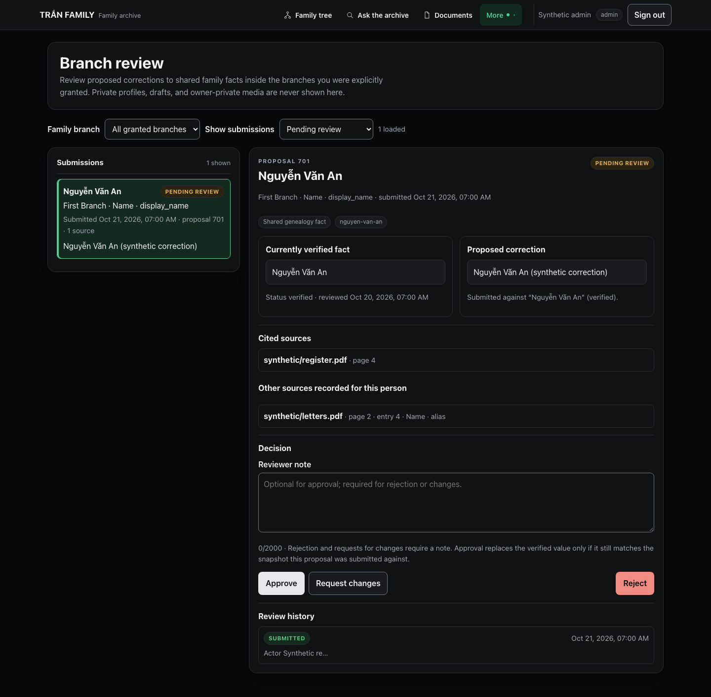    |

Both consoles gain a queue header with a visible count, a stronger selected-row
state, a dashed placeholder before selection, and a destructive Reject action
separated from Approve and Request changes. The current/proposed comparison,
cited evidence, reviewer note, confirmation step, decision blocks, and history
are unchanged.

### Mobile

| Documents (390px light)                                                | Admin review (390px light)                                             | Branch review (390px dark)                                              |
| ---------------------------------------------------------------------- | ---------------------------------------------------------------------- | ----------------------------------------------------------------------- |
| 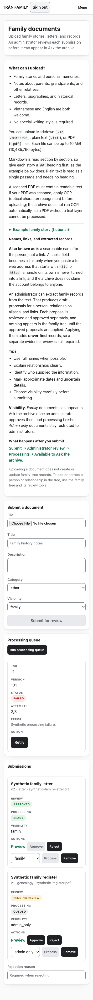         | 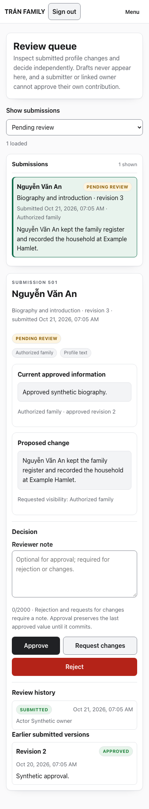        | 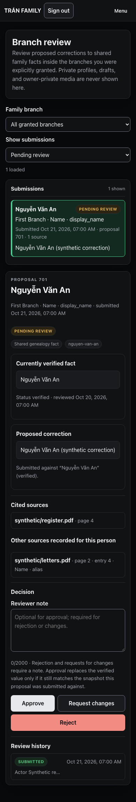     |

At 390 px each document and job row becomes a labelled card; the queue and
detail stack; filters, notes, and action buttons fill the available width.
There is no horizontal page overflow.

## What changed

- `web/src/app/documents/page.tsx`: readable status labels, semantic chips, and
  `data-label` cells for the stacked mobile layout. All handlers and test IDs
  are unchanged.
- `web/src/components/ReviewConsole.tsx` and
  `web/src/components/BranchReviewConsole.tsx`: queue headers, empty/placeholder
  panels, a secondary retry action, and a separated destructive action. The
  branch loading/no-authority states now use the shared state panels.
- `web/src/app/globals.css`: workspace-scoped surfaces, document status chips,
  mobile card rows, review hierarchy, and two contrast fixes (see below).
- `web/e2e/workspace-visual.spec.ts`: fully mocked desktop/mobile/theme suite.
- `web/scripts/capture-ui-reskin-stage5.mjs`: synthetic before/after capture.
- `docs/plans/PLAN-TRAN-UI-RESKIN-STAGE-5.md`: the stage-five contract.

No Rust, API, migration, authentication, authorization, privacy, review, upload,
or publication behavior changed.

## Defects found and fixed

1. **Selected review row contrast.** The generic `button:hover:not(:disabled)`
   rule has higher specificity than `.review-row.selected`, so a hovered
   selected row was painted with `--action-hover` (white in dark mode) while
   keeping near-white text. The queue-scoped `.review-row.selected:hover` rule
   now keeps `--accent-soft`.
2. **Dark-mode Reject button contrast.** `--err` is a light red in dark mode, so
   white text was unreadable. Review danger actions now use `--bg` text in dark
   mode.

## Verification

The browser run used an isolated production build on `127.0.0.1:3001`; the
existing local app on `3000` and the API on `8080` were left running and
untouched. All screenshots use synthetic data.

| Check                                                                  | Result              |
| ---------------------------------------------------------------------- | ------------------- |
| `scripts/web-control.sh typecheck`                                     | **PASS**            |
| `scripts/web-control.sh build`                                         | **PASS**            |
| `npx playwright test e2e/workspace-visual.spec.ts`                     | **PASS — 7/7**      |
| `npx playwright test e2e/experience.spec.ts`                           | **PASS** (part of 48) |
| `npx playwright test e2e/family-profile-visual.spec.ts`                | **PASS** (part of 48) |
| `npx playwright test e2e/my-profile-visual.spec.ts`                    | **PASS** (part of 48) |
| Combined regression run above                                          | **PASS — 48/48**    |
| `npx playwright test e2e/documents-guidance.spec.ts`                   | **1 passed, 4 skipped** (token-gated) |
| 390px overflow assertions (documents, admin, branch)                   | **PASS — 0 px**     |
| Selected-row and Reject contrast, light and dark                       | **PASS** (verified from computed styles) |
| Light/dark `--bg` tokens unchanged                                     | **PASS**            |
| `git diff --check`                                                     | **PASS**            |

The baseline run of `workspace-visual.spec.ts` before the reskin failed 2 of 7:
the missing `.status-chip` and a 168 px overflow at 390 px. The final run passes
all 7.

### SOP disposition

- Task: `UI-501` (governed ad-hoc task; the archived-photographs plan and its
  AP-106–AP-109 tasks were not touched).
- Routing: LARGE / `ollama` / `deepseek-v4.1-flash:cloud`.
- SOP stage: `PASSED`; gate: `PASS`; fix cycles: 1/3; lifecycle `LOCAL_DONE`.
- Outcome: `PARTIAL`/`HOLD` **only** because the declared acceptance-check
  commands require Node and browser execution, which SOP's command policy
  classifies as `REQUIRES_APPROVAL` (it permits read-only `git` and `go`). The
  operator therefore ran the deterministic gate above and recorded the results
  here; SOP executed only `git diff --check`. No acceptance decision or waiver
  was recorded on the operator's behalf.
- SOP implemented `/documents` and the CSS and self-reported that the review
  consoles were unchanged. Those gaps, the mobile card layout, and both contrast
  defects were completed/fixed by targeted edits after the run and re-verified.

### Not run

- Real-API `review-console.spec.ts`, `branch-review.spec.ts`,
  `branch-review-ui.spec.ts`, `branch-review-security.spec.ts`, and
  `documents-guidance.spec.ts` browser cases require `scripts/web-e2e.sh` with
  the synthetic OIDC issuer and seeded disposable databases. The local app/API
  ports were already occupied, so they were **not** started or claimed as
  passing. The mocked `workspace-visual.spec.ts` covers the same rendering paths
  without real enforcement.
- The stage-one live-RAG timeout remains **outstanding** and was not rerun.

## Known limitations

- Theme follows the system preference only; no manual selector was added.
- The mobile card layout is CSS-driven from the same table DOM, so a screen
  reader still encounters a table with hidden headers; the cells carry visible
  labels in the card layout.
- Real-API authorization and privacy behavior for these routes remains
  operator/CI coverage; this stage changed presentation only.
