# UI reskin — stage 6

**Status:** Implemented; awaiting review. **Scope:** the Head of Family page at
`/head-of-family`. The stage-3 shell, top navigation, light/dark tokens, shared
state panels, and restrained jade are reused unchanged.

Previous stage: PR #111 merged as `cf5cd5c` and delivered stage 5 (documents and
both review consoles). This stage does not replay that work.

## Direction

The page now presents the designation as a genealogy fact, not a generic record
list: a designation hero names the cited head, states that the designation is
separate from application administrator permissions, and shows the active
appointment count and evidence status. Record and appointment identifiers sit as
quiet metadata; cited sources have their own surface and still open the
metadata-only source dialog. Nomination, approval, and revocation keep their
confirmation steps, with revocation and rejection separated from approval.

No Rust, API contract, route, permission, designation rule, confirmation step,
or existing test ID changed. A successor is never inferred.

## Before

| Desktop light                                          | Mobile light                                                   |
| ------------------------------------------------------ | -------------------------------------------------------------- |
| 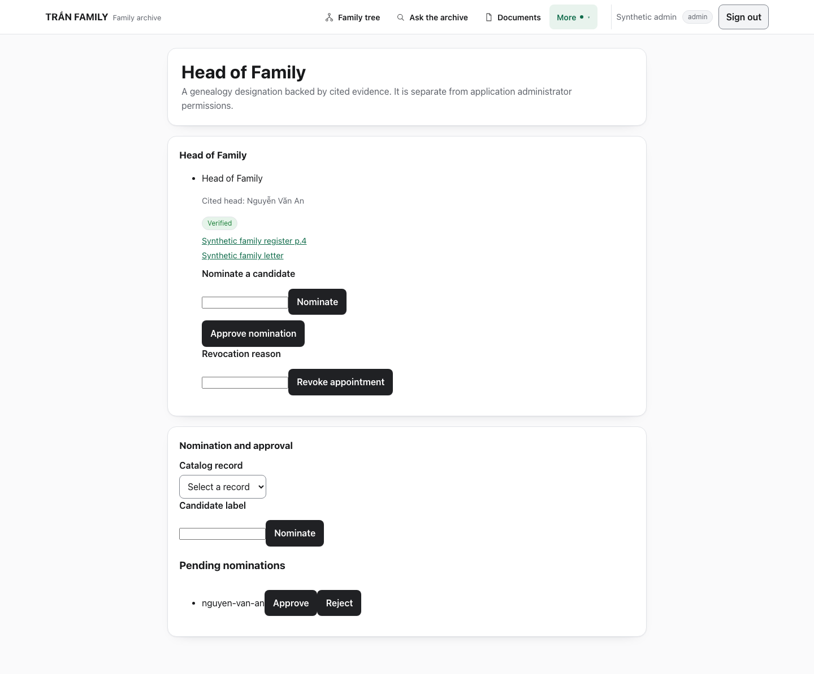 | 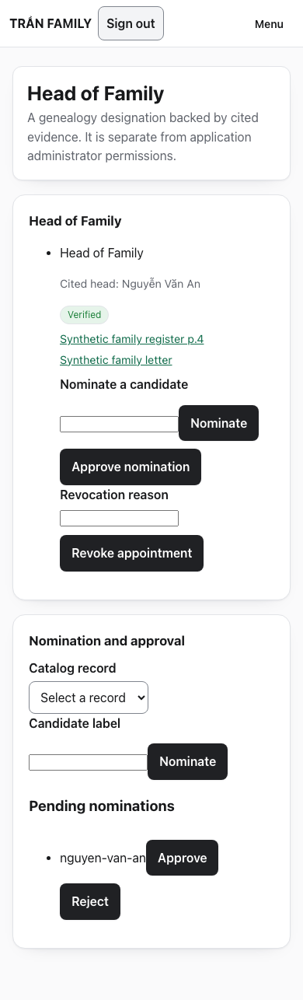           |
| **Empty state (no panel)**                             | **Catalog unavailable**                                        |
| 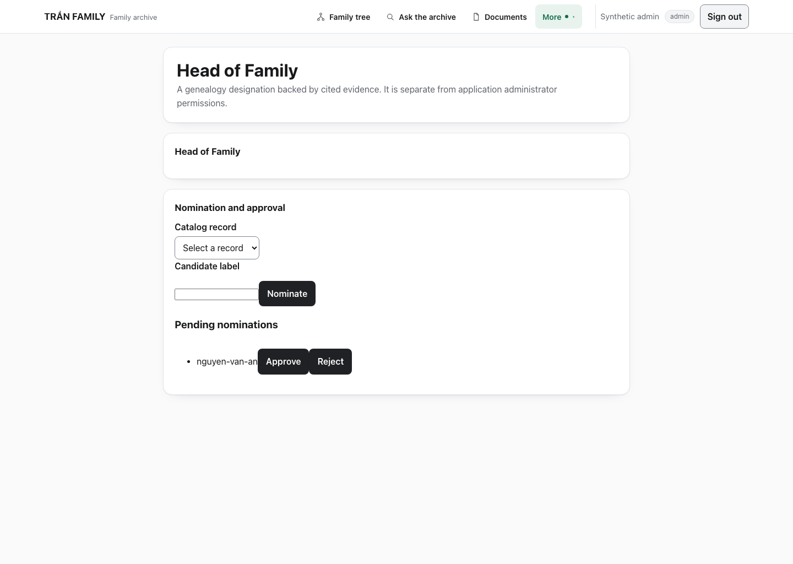     | 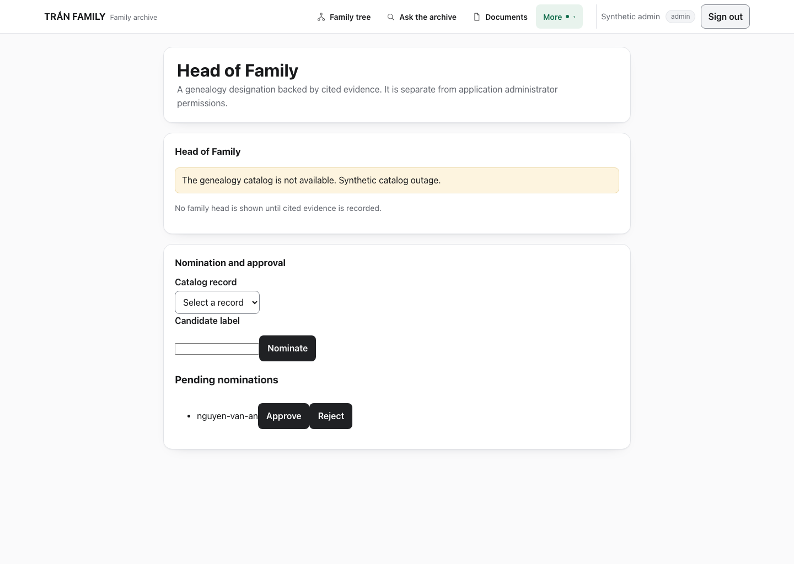 |

The baseline was an unstyled bullet list with raw enum-like metadata, no empty
state, no sign-in action on expiry, and no keyboard focus handling.

## After

### Designation and evidence

| Light                                                      | Dark                                                     |
| ---------------------------------------------------------- | -------------------------------------------------------- |
| 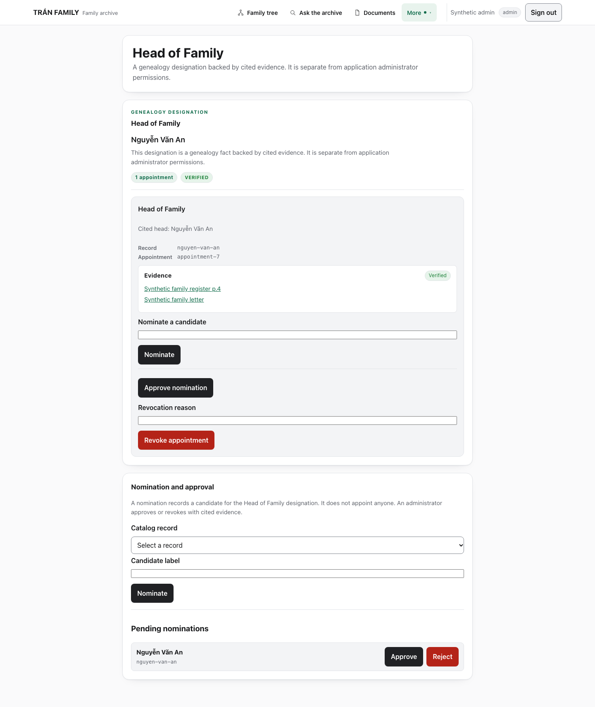 | 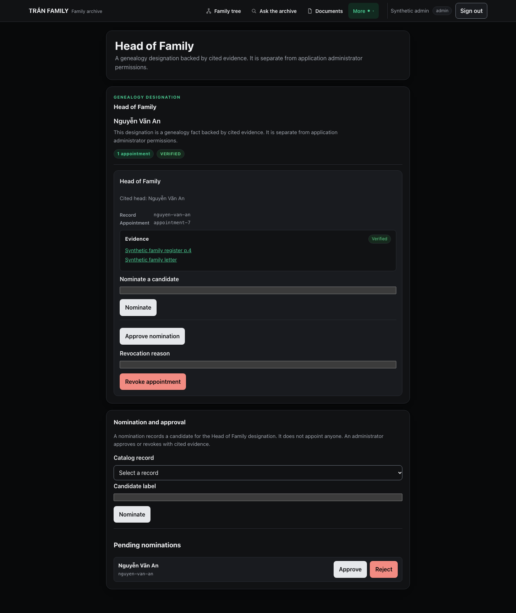 |

The hero keeps the page title, adds a `Genealogy designation` eyebrow, the cited
head's name, a scope note, an appointment-count chip, and a semantic status chip.
Each conclusion shows the cited head, record/appointment metadata, a verified /
unverified / needs-review badge, and its citation buttons.

### States

| Empty                                                    | Unavailable                                                  |
| -------------------------------------------------------- | ------------------------------------------------------------ |
| 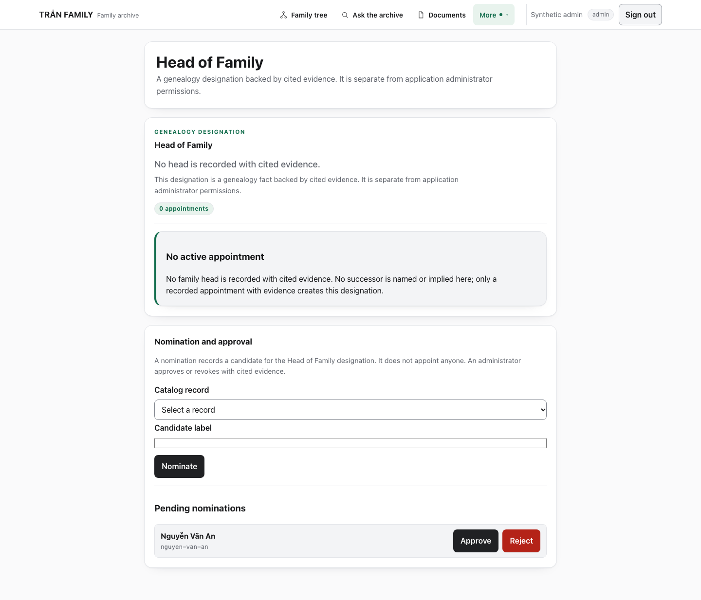         | 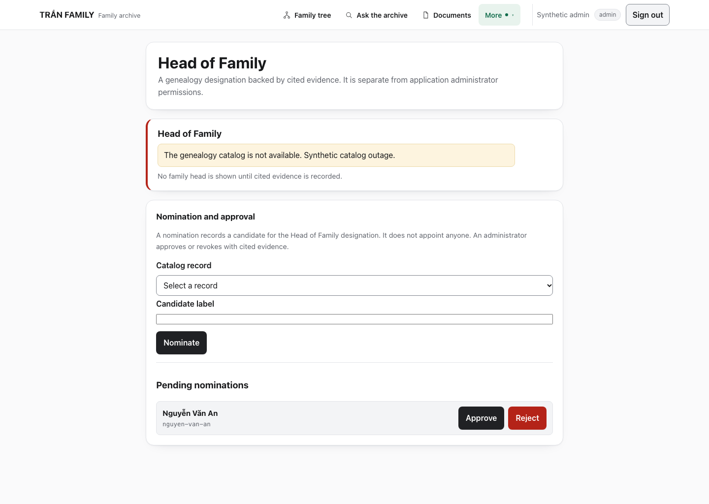 |
| **Confirm (dark)**                                       | **Mobile confirm (light)**                                   |
| 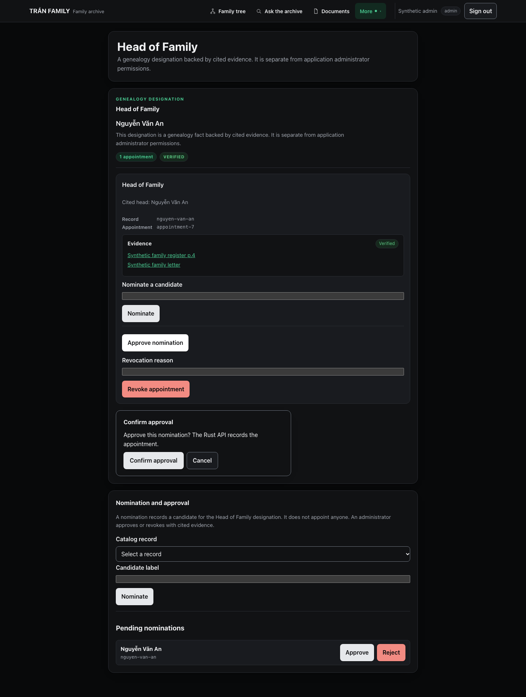 | 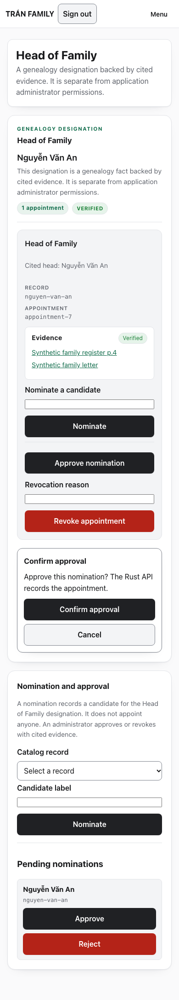   |

- Loading: shared loading panel with `role="status"` and `aria-busy`.
- Empty: explicit “No active appointment” panel that names no successor.
- Denied / no access: distinct panels with a back-to-tree action.
- Expired: sign-in panel with a sign-in action.
- Catalog unavailable: explicit panel with no inferred head.

### Mobile

| Light                                                | Dark                                               |
| ---------------------------------------------------- | -------------------------------------------------- |
| 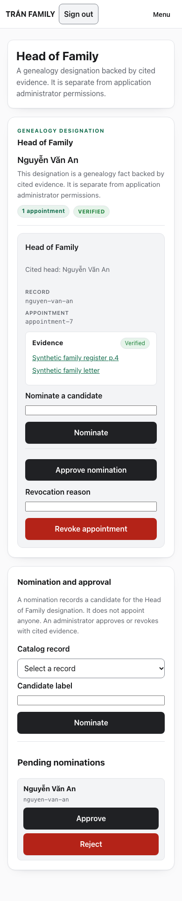 | 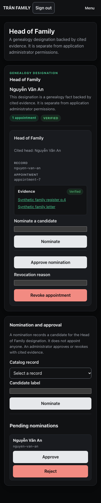 |

At 390px the hero, metadata, evidence, forms, and pending nominations stack;
buttons fill the width; Vietnamese diacritics wrap without clipping. There is no
horizontal page overflow.

## What changed

- `web/src/app/head-of-family/page.tsx`: shared loading panel with status
  semantics.
- `web/src/components/HeadOfFamilyView.tsx`: designation hero, metadata,
  evidence surface, empty/denied/no-access/expired/unavailable panels, back
  links, and a keyboard-operable confirmation dialog (focus, Escape, focus loop).
- `web/src/components/HeadOfFamilyActions.tsx`: grouped nomination forms,
  person-labelled pending nominations, separated reject action, and the same
  keyboard-operable confirmation dialog.
- `web/src/app/globals.css`: `hof-*` scoped rules only; no existing selector is
  changed outside this surface.
- `web/e2e/head-of-family-visual.spec.ts` (new, fully mocked).
- `web/scripts/capture-ui-reskin-stage6.mjs` (new, synthetic before/after).
- `docs/reports/ui-reskin/stage-6/inventory.md`: preserved API calls, result
  kinds, and role gates.

## Defects found and fixed

1. The hero and the evidence group both rendered the `evidence-verified` test ID,
   which breaks strict locators. The hero now uses a semantic `status-chip`.
2. Escape cancelled the view's confirm dialog without restoring focus to the
   opening control; focus is now restored.
3. Denied and no-access panels were visually identical and had no exit; they now
   differ and offer “Back to the family tree”.
4. Dark-mode danger actions needed readable text on the light `--err` token.
5. Desktop form buttons stretched full width; they are now content-sized on
   desktop and full-width below 560px.

## Verification

Run against an isolated production build on `127.0.0.1:3001`; the existing app on
`3000` and API on `8080` were left running. All screenshots use synthetic data.

| Check                                                                                                                                     | Result                                   |
| ----------------------------------------------------------------------------------------------------------------------------------------- | ---------------------------------------- |
| `scripts/web-control.sh typecheck`                                                                                                        | **PASS**                                 |
| `scripts/web-control.sh build`                                                                                                            | **PASS**                                 |
| `npx playwright test e2e/head-of-family-visual.spec.ts`                                                                                   | **PASS — 11/11**                         |
| `npx playwright test e2e/experience.spec.ts e2e/workspace-visual.spec.ts e2e/family-profile-visual.spec.ts e2e/my-profile-visual.spec.ts` | **PASS — 55/55**                         |
| `npx playwright test e2e/documents-guidance.spec.ts`                                                                                      | **1 passed, 4 skipped** (token-gated)    |
| `npx playwright test e2e/head-of-family-real.spec.ts`                                                                                     | **skipped** (needs `E2E_APPROVER_TOKEN`) |
| 390px and dialog-open overflow assertions                                                                                                 | **PASS — 0 px**                          |
| Confirm focus, Escape cancel, focus restore                                                                                               | **PASS**                                 |
| Light/dark `--bg` tokens unchanged                                                                                                        | **PASS**                                 |
| `git diff --check`                                                                                                                        | **PASS**                                 |

Baseline before the reskin: the mocked suite failed 4 of 11 (hero metadata,
confirm focus/Escape, empty state, expired sign-in) and passed 8.

### SOP disposition

- Task: `UI-601` (governed ad-hoc task; the archive-photographs plan and
  AP-106–AP-109 were not touched).
- Routing: LARGE / `ollama` / `deepseek-v4.1-flash:cloud`.
- SOP stage: `PASSED`; gate: `PASS`; fix cycles: 0/3; lifecycle `LOCAL_DONE`.
- Outcome: `PARTIAL`. `check-1` (`git diff --check`) is **met**; the seven
  criteria are informational because the Node/build/browser checks are outside
  SOP's command policy (read-only `git`/`go` only). The operator ran the
  deterministic gate above and recorded it here. No acceptance decision or
  waiver was recorded on the operator's behalf.
- SOP implemented the hero, state panels, and keyboard dialogs. The operator then
  fixed the duplicate evidence test ID, Escape focus restore, denied/no-access
  distinction, danger-button contrast, desktop button sizing, person-labelled
  pending nominations, and restored the theme/secret/390px assertions.

### Not run

- `head-of-family-real.spec.ts` (real OIDC sign-in, nominate/approve/revoke) needs
  `scripts/web-e2e.sh` with the synthetic issuer and seeded disposable databases.
  The harness was not started because the local app/API ports were in use; it is
  **not** claimed as passing. The mocked suite covers the same rendering paths.
- The stage-one live-RAG timeout remains **outstanding** and was not rerun.

## Known limitations

- Theme follows the system preference only; no manual selector was added.
- Confirmation panels remain inline within the page (existing behavior) rather
  than modal overlays; they are keyboard operable and focus-restoring.
- The per-conclusion approve control and its fallback identifier are unchanged to
  preserve existing workflows; the separate pending-nomination list carries the
  authoritative nomination identifiers.
- Real-API authorization, privacy, and mutation behavior remains operator/CI
  coverage; this stage changed presentation and keyboard access only.
