# UI reskin — stage 8 (final)

**Status:** Implemented; awaiting review. **Scope:** `/signin` and the shared
denied/no-access presentation. The stage-3 shell, top navigation, light/dark
tokens, shared state panels, and restrained jade are reused unchanged.

Previous stage: PR #113 merged as `61ce4c4` and delivered stage 7 (the four admin
consoles). This stage does not replay that work.

## Direction

`/signin` is now a normal page inside the shared `ExperienceShell`: same top
navigation, account menu, surfaces, and focus treatment as every other screen.
It carries an eyebrow, one clear heading, the administrator-provisioning note,
one primary `Sign in` action (still a plain link to `/api/auth/login`), and a
short "what you need" side list that stacks beneath the action on a phone.

Three states are explicit and visually distinct:

- **Configured** — a `card` auth panel with the sign-in action.
- **Unconfigured** — the same content inside `state-panel-unavailable`, naming
  the operator action and offering no fabricated sign-in control.
- **Error** — a mapped message above the panel in a `role="alert"` state panel.

`DenialView` also moves from the unstyled `card denial` to the shared
`state-panel state-panel-unavailable` surface, so every denied and no-access
view in the app matches the loading, empty, expired, and unavailable panels used
by the rest of the reskin.

No Rust, API contract, auth route, redirect, cookie, session call, permission,
error code, or existing test ID changed. The primary sign-in action stays
neutral; jade remains a restrained accent (eyebrow and focus ring).

## Before

| Sign-in (light)                                       | Sign-in error (dark)                                                    |
| ----------------------------------------------------- | ----------------------------------------------------------------------- |
| 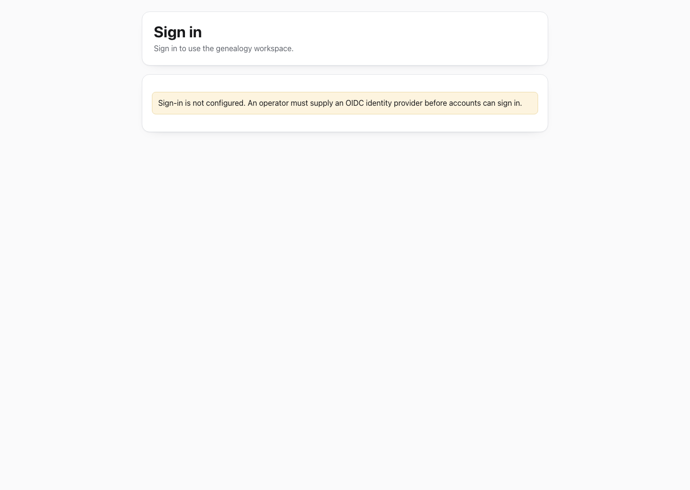 | 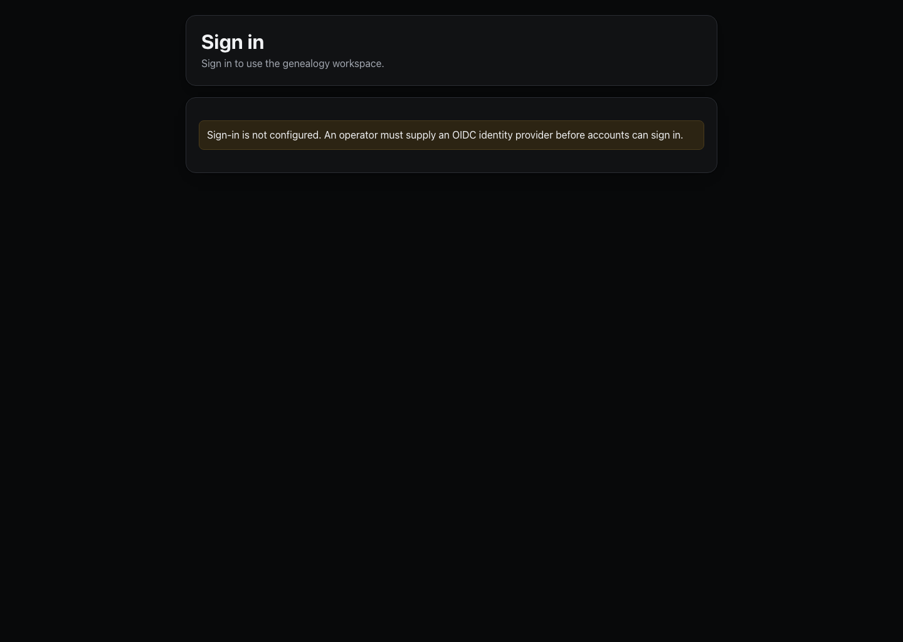        |
| **Denied (light)**                                    | **Unconfigured (light)**                                                |
| 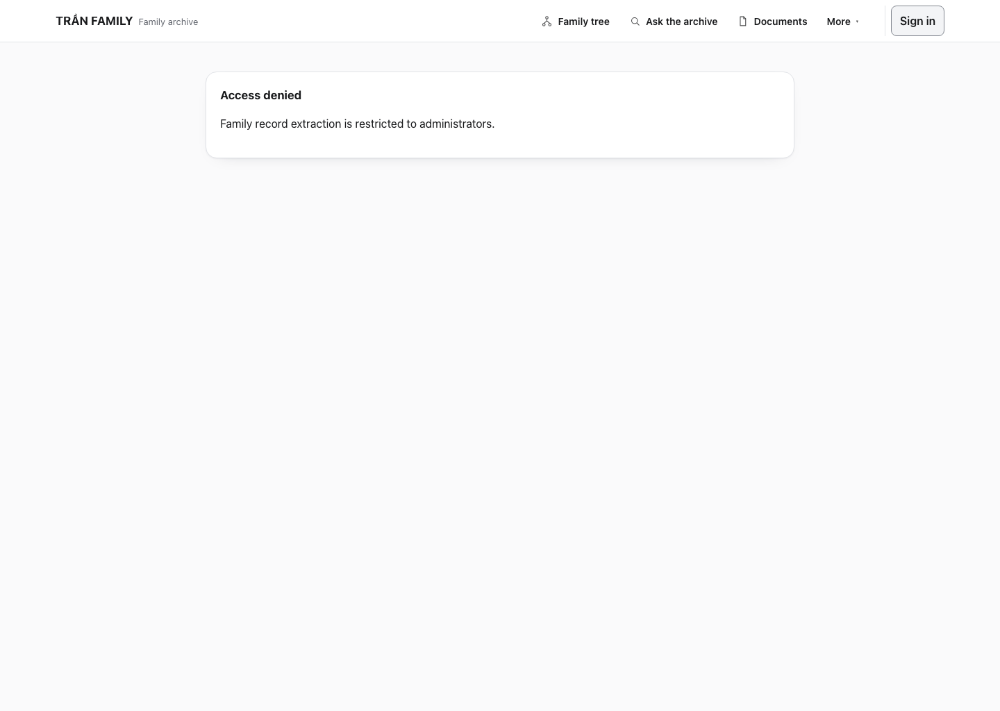  |  |

The baseline had no header or navigation, no eyebrow, no side list, and an
inline amber notice instead of a state panel. Denied views were a plain card
with no semantic surface, and the mobile layout had no full-width action.

## After

### Desktop

| Sign-in (light)                                         | Sign-in (dark)                                              |
| ------------------------------------------------------- | ----------------------------------------------------------- |
| 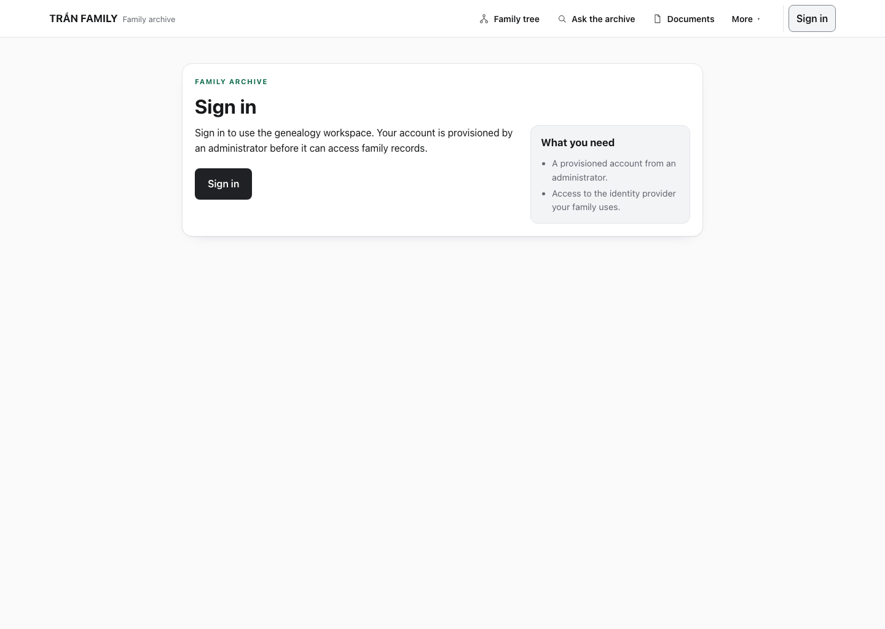     | 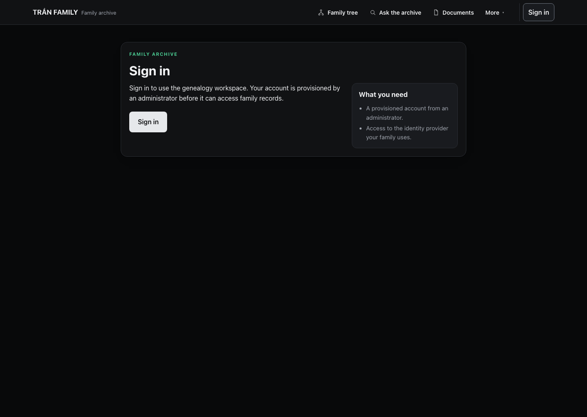     |
| **Sign-in error (light)**                               | **Sign-in error (dark)**                                    |
| 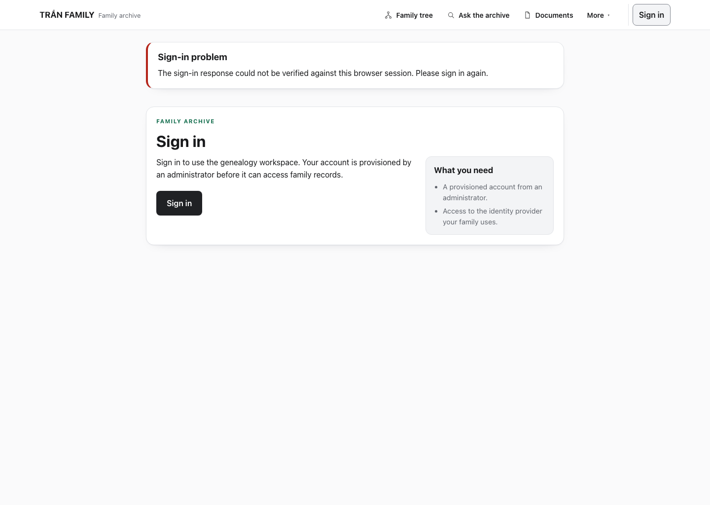 | 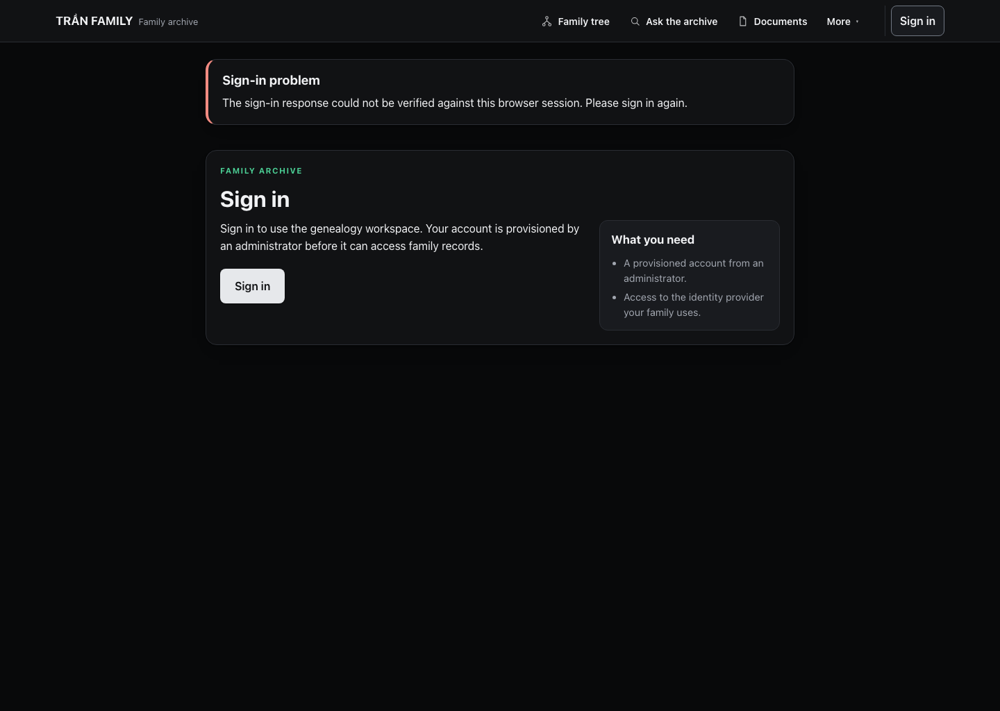 |
| **Denied (light)**                                      | **Denied (dark)**                                           |
| 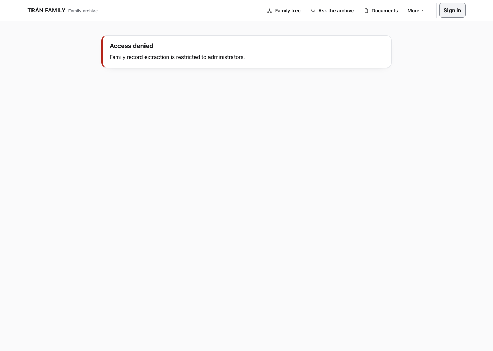      | 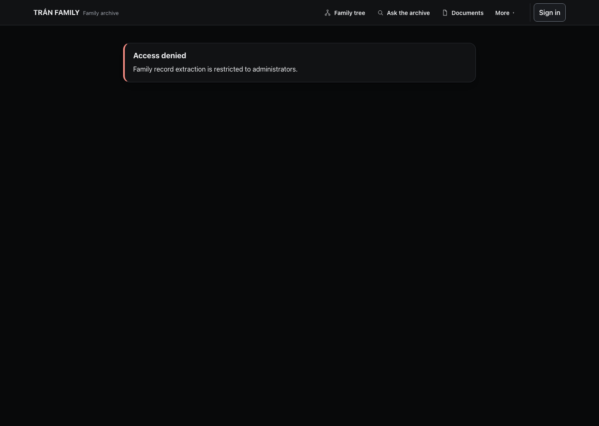      |

### Unconfigured (operator state)

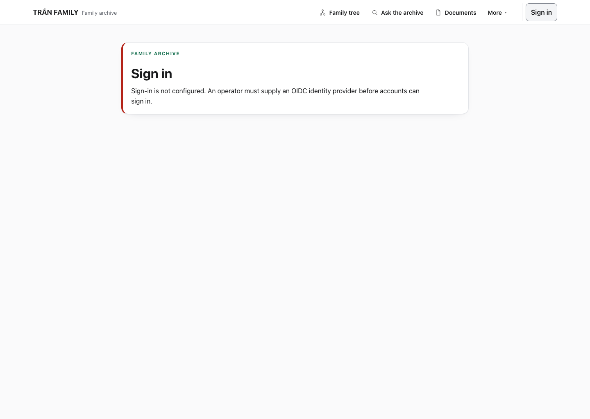

The message names the operator action and there is no sign-in control.

### Mobile (390 px)

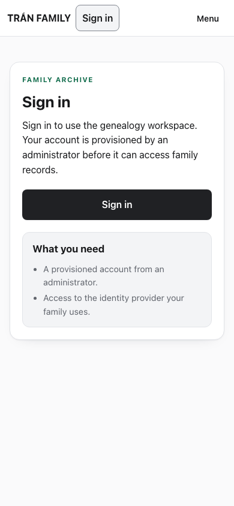

The action goes full width, the side list stacks under it, and the page has no
horizontal overflow.

## What changed

- `web/src/app/signin/SignInShell.tsx` (new): a thin client wrapper that renders
  the page inside `ExperienceShell` and maps a fixed, safe message for each
  identity-provider error code (`unconfigured`, `invalid_callback`,
  `state_mismatch`, `missing_id_token`, `invalid_id_token`,
  `token_exchange_failed`, `provider_unavailable`, `not_provisioned`,
  `session_denied`, `account_unavailable`, and a generic fallback). It never
  echoes the raw query value. It does not touch any auth route.
- `web/src/app/signin/page.tsx`: eyebrow, heading, the provisioning note, the
  primary action, and the side list. The configured state uses `card`; the
  unconfigured state uses `state-panel-unavailable`. Keeps
  `data-testid="signin-view"` and `data-testid="signin-button"` with
  `href="/api/auth/login"`.
- `web/src/components/DenialView.tsx`: `card denial` → shared
  `state-panel state-panel-unavailable`; `data-testid` (`denied-view`,
  `no-access-view`), `role="alert"`, heading, and reason text are unchanged.
- `web/src/app/globals.css`: scoped `signin-*` rules plus denial wrapping. No
  token value changed and no unrelated selector was edited.
- `web/e2e/signin-visual.spec.ts` (new, fully mocked, 6 cases).
- `web/scripts/capture-ui-reskin-stage8.mjs` (new, synthetic capture).

## Defects found and fixed

1. `/signin` rendered outside the app shell, so it had no navigation, no
   account menu, and no shared focus treatment. It now uses `ExperienceShell`.
2. The unconfigured state was an inline amber notice (`form-status`) rather than
   a page state. It is now an explicit `state-panel-unavailable` panel.
3. Provider error codes were not surfaced at all: a failed callback landed on a
   bare sign-in card. Each code now maps to one fixed, safe sentence, and the
   raw parameter is never echoed.
4. `DenialView` used `card denial`, a class with no dedicated styles, so denied
   and no-access panels did not match the shared state language. It now uses the
   shared unavailable panel.
5. At 390 px the sign-in action was inline and the aside had no stacking rule.
   The action is now full width at 420 px and the two-column body collapses at
   640 px.

## Verification

Run against an isolated production build on `127.0.0.1:3001` (configured OIDC)
and a second build on `127.0.0.1:3002` (empty `OIDC_*`) for the unconfigured
state. The existing app on `3000` and API on `8080` were left running. All
screenshots and fixtures use synthetic data.

| Check                                                                                                                                   | Result                        |
| --------------------------------------------------------------------------------------------------------------------------------------- | ----------------------------- |
| `scripts/web-control.sh typecheck`                                                                                                      | **PASS**                      |
| `scripts/web-control.sh build`                                                                                                          | **PASS**                      |
| `npx playwright test e2e/signin-visual.spec.ts`                                                                                         | **PASS — 6/6** (baseline 3/6) |
| `experience` + `admin-workspaces-visual` + `workspace-visual` + `head-of-family-visual` + `family-profile-visual` + `my-profile-visual` | **PASS — 79/79**              |
| 390 px horizontal overflow (sign-in, sign-in error, denied)                                                                             | **PASS — 0 px**               |
| Light/dark `--bg` tokens unchanged                                                                                                      | **PASS**                      |
| Confirmation and sign-in focus (`toBeFocused`)                                                                                          | **PASS**                      |
| `git diff --check`                                                                                                                      | **PASS**                      |

Baseline before implementation: the mocked sign-in suite failed 3 of 6 (shared
shell, error mapping, denial panel class) and passed 3.

The regression suites were rerun rather than reused because `DenialView` is
imported by several of them; all 79 passed after the change.

### SOP disposition

The stage ran as governed ad-hoc task **`UI-801`** (`.agent-sdlc/tasks/UI-801.md`)
on branch `feat/ui-reskin-stage-8`, at the working model routing
LARGE / `ollama` / `deepseek-v4.1-flash:cloud`:

- stage `PASSED`, gate `PASS`, 0/3 fix cycles, lifecycle `LOCAL_DONE`,
  outcome **`PARTIAL`**.
- `git diff --check` (the only check inside SOP's command policy) **met**;
  `changed-files.json` records `web/src/app/signin/page.tsx` and
  `web/src/app/signin/SignInShell.tsx`.
- The `PARTIAL` outcome is **not** a failure and **not** an acceptance decision.
  SOP reported the remaining criteria as "unverifiable: no deterministic check
  supplied" because Node, build, and browser execution are `REQUIRES_APPROVAL`
  in SOP's command policy, and this task file has no `### Acceptance Mapping`
  section, so criteria 1–5 stay informational. No decision or waiver was
  recorded on the operator's behalf.

Two residual edits were made by the operator outside that governed diff, and are
therefore **not** covered by `UI-801`'s change record: the unconfigured-state
panel class in `page.tsx` and the `state_mismatch` message wording in
`SignInShell.tsx`, plus the operator-authored `DenialView.tsx` and
`globals.css` changes. They are covered here only by the operator-run gate in
the table above.

### Not run

- Token-gated real-API suites (`auth`, `admin-accounts`, `bulk-onboarding`,
  `narrative-review`, `session-expiry`, `session-renewal`,
  `head-of-family-real`, and the other `scripts/web-e2e.sh` cases) need the
  synthetic OIDC issuer and seeded disposable databases. They were not run and
  are **not** claimed as passing. This stage changed presentation only; no auth
  route, redirect, cookie, session call, permission, or API contract changed.
- The stage-one live-RAG timeout remains **outstanding** and was not rerun.

## Known limitations

- The sign-in page reads the `error` query parameter in a client shell, so the
  safe message appears after hydration. The page itself stays `force-dynamic`
  and server-rendered; there is no loading flash of a fabricated identity.
- Theme still follows the system preference only; no manual selector was added.
- Inline field-level validation messages elsewhere in the app
  (`form-status error`, `.hint`, `.insufficient`) intentionally keep their
  existing inline pattern. They are not page states and were left alone rather
  than redesigned in a finalization stage.
- Real-API authorization and privacy behavior remains operator/CI coverage.
